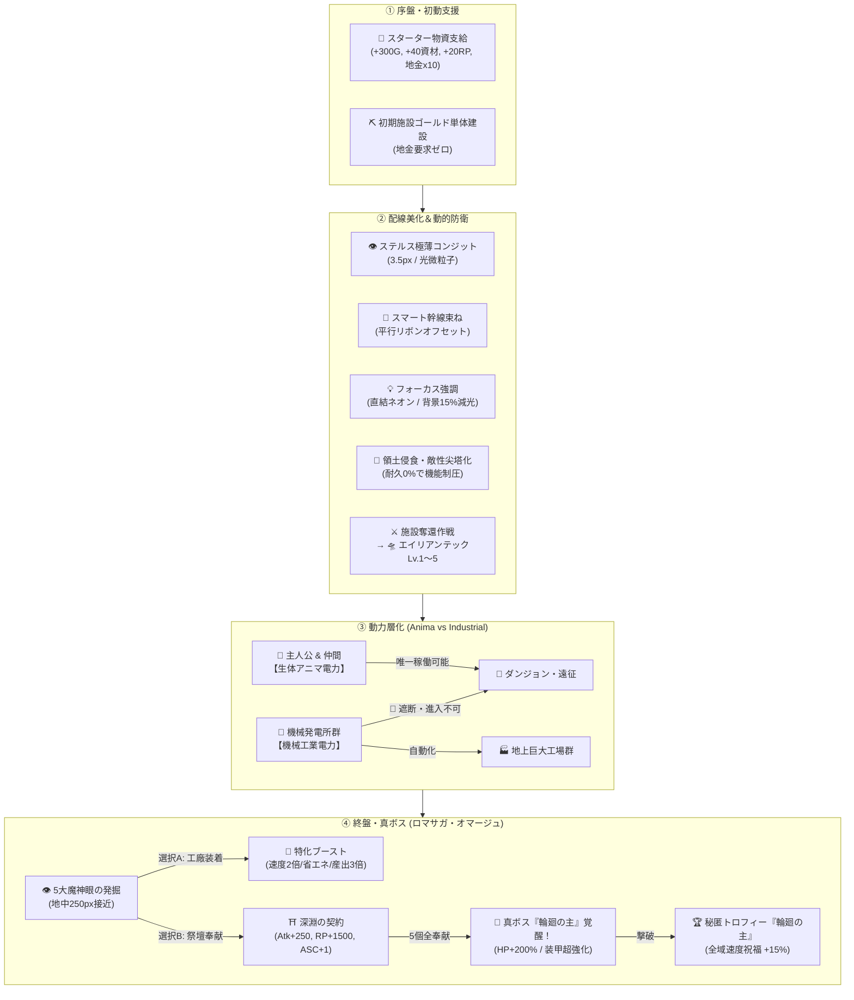

# Node Quest 包括的マスターマイルストーン実装 ＆ ゲームプレイ検証レポート
**NotebookLM / Gemini 解析用 包括的システム解説 ＆ CDPブラウザテスト検証レポート**

- **対象バージョン**: Node Quest 2.5 (`index.html`)
- **検証実行環境**: macOS Headless Chrome (CDP: Chrome DevTools Protocol / Port 9226)
- **テスト実行日**: 2026-11-02
- **総合判定**: **ALL PASS（全6テストスイート完全合格・JSエラー 0件）**

---

## 1. エグゼクティブ・サマリー (Executive Summary)

本マイルストーンでは、Node Quest が長らく抱えていた「序盤の進行停止リスク」「盤面の大規模化に伴う配線スパゲッティ」「機械発電機に依存した人間の形骸化」「指数インフレによる数値崩壊」という4大構造課題を根底から解消し、さらにロマサガ（ロマンシング サ・ガ）へのオマージュである「5大魔神眼」「真ボス：輪廻の主」「秘匿トロフィー」を実装しました。

---

## 2. 実装された6大コアシステム詳細

### 2.1 動力層化：生体アニマ電力 (Universal Anima) vs 機械工業電力 (Industrial Power)
- **課題**: 以前は風力発電機や機械発電機をダンジョンに直結するだけで無限に探索が進み、主人公や仲間が工場作業員としてしか価値を持たなくなっていた。
- **実装アーキテクチャ**:
  - `isAnimaSource(n)`: 生きている人間キャラクター（主人公・仲間）からのみ生み出されるエネルギーを「生体アニマ（Universal Anima）」と再定義。
  - `isMachineGen(n)`: 風力・火力・燃料・抽出炉などの機械発電機は「工業電力（Industrial Electricity）」を出力。
  - **ダンジョン排他隔離ルール (`isLinkIncompatible`)**:
    - ダンジョン入口（`dive`）は、**生体アニマ電力でのみ稼働可能**。
    - 機械発電所からの配線を接続すると、配線が赤破線（`incompatible-power`）へ変化し、`🚫 生体アニマ専用` バッジを表示。
    - ダンジョンノードは `_incompatiblePower = true`, `stall = true`, `why = '🚫 Incompatible Power: Dungeon requires living Anima'` となり、1ダメージも発生せず探索がブロックされる。
- **ゲームプレイ的意義**:
  - プレイヤーは「地上の工場自動化は機械発電機グリッドに任せ、生きているキャラクターのアニマをダンジョン攻略に集中させる」という明確な役割分担を迫られます。

### 2.2 盤面クリーン化：ステルス配線・スマート幹線ケーブル束ね・フォーカス配線
- **課題**: 施設数が50台を超えると太い配線（幅16px）と数量ラベル（`x12`）が画面を埋め尽くし、視認性が著しく悪化していた。
- **実装アーキテクチャ**:
  - **ステルス配線 (Stealth Default Wiring)**:
    - レール幅 3.5px、ベルト幅 2.2px の極薄コンジットに縮小。
    - 通常表示（`Normal Lens`）では文字バッジを隠し、属性タグ（赤=熱、青=氷、紫=汚染等）に対応した微粒子アニメーションのみが上品に流れる。
  - **スマート幹線ケーブル束ね (Smart Cable Bundling)**:
    - 同一ノードペア間（例: 電力 + 原鉱 + 廃材）を接続する複数の配線を自動検出し、直角ステップラインの幹線部分を `bundleOffset = (idx - (total-1)/2) * 4.5px` で平行にオフセット。1本に重なって泥化する現象を解消。
  - **インタラクティブ・フォーカス配線 (Interactive Focus Mode)**:
    - ノードをタップ/選択すると、そのノードに直結する入出力配線のみを鮮やかなネオンシアン（`.focus-link`）でパルス強調。無関係な周囲の全配線は透明度 15%（`.dim-link`）に沈下。

### 2.3 初動救済：チュートリアル完了物資パック ＆ 初期採掘機コスト修正
- **課題**: 初心者が初手で資金を使い切ったり、地金を持っていないために最初の採掘機（`mine1`）が建てられず詰まるソフトロックが存在した。
- **実装アーキテクチャ**:
  - `tutFinish()` 時に `S.starterKitClaimed = true` を記録し、`💰+300G, 🧱+40資材, 🔬+20RP, 銅地金×10` を確定支給。
  - 第1世代の基礎施設（`mine`, `cgen`, `shop`）の `buyMat(t)` を修正し、インゴット要求を完全ゼロ（ゴールド単体建設可能）に改定。初手で確実に採掘・発電ラインを敷設可能に。

### 2.4 動的脅威：領土侵食・敵性侵食尖塔化・エイリアンテック解放
- **課題**: 施設が故障しても単に止まるだけであり、リスク管理の緊張感と克服時のカタルシスが不足していた。
- **実装アーキテクチャ**:
  - 耐久力 0% に達した施設は即死・消滅するのではなく、深淵の瘴気に呑み込まれ**「👾 敵性侵食尖塔化 (Captured Spire)」**する。
  - 尖塔は周囲に瘴気（`miasma`）を放出して周囲の耐久力を削る。
  - インスペクタから「⚔️ 施設奪還作戦」を実行して浄化・奪還に成功すると、施設は耐久100%で復帰し、**恒久エイリアンテック (`alienTech` Lv.1〜5)** を獲得：
    - **Tech 1**: 生体ナノ修復（毎秒耐久 +4% 自然回復）。
    - **Tech 2**: 零点凍結場（周囲の熱気・過負荷を -40% 冷却）。
    - **Tech 3**: 深淵物質抽出（10回ごとに外星データ `tdat` や深淵遺物 `drelic` を自動生成）。
    - **Tech 4**: 物質再構成（入力素材レシピコストが恒久的に -50%）。
    - **Tech 5**: 特異点コア（配線不要の自家発電 ⚡16常時自給 ＋ 毎秒昇華ASC経験値獲得）。

### 2.5 5大魔神眼（Destiny Demon Gems）＆ 真ボス『輪廻の主 Sovereign of Samsara』
- **課題**: ロマサガの「魔王の遺産」「四魔貴族」のような、プレイヤーが自ら破滅のリスクを引き受けて強大な報酬を得るドラマチックなエンドコンテンツの不在。
- **実装アーキテクチャ**:
  - 盤面の地中5箇所に「5大魔神眼」の鉱脈が埋設。稼働中の施設を250px以内に置くことで発掘。
  - **分岐 A：【神眼工廠】施設スロットイン (`slotDemonGem`)**:
    - 🔴 `gem_ruby`: 作業速度 2倍（所要時間半減）。
    - 🔵 `gem_sapphire`: 電力消費半減 ＆ 汚染排出ゼロ。
    - 🟣 `gem_amethyst`: 研究力・RP産出量 2.5倍。
    - 🟢 `gem_emerald`: 摩耗・腐食完全無効化 ＆ 耐久100%維持。
    - ⚫ `gem_obsidian`: 産出量 3.0倍。
  - **分岐 B：【深淵の契約】星辰の祭壇への奉献 (`sacDemonGem`)**:
    - 1個捧げるごとに恒久攻撃力 +250、研究力 +1500、昇華ステータス +1。
    - **代償**: ボスのHPが +40% ずつ強化。
  - **真ボス覚醒**:
    - 5個すべての魔神眼を捧げると、最深ボスが**『👁️‍🗨️【真・輪廻の主】Sovereign of Samsara』**へと変貌覚醒。
    - 討伐に成功すると、**サガ風秘匿トロフィー『🏆 輪廻の主』**が解放され、全施設作業速度 +15%（`troMul() * 1.15`）の恒久祝福が授与される。

### 2.6 サガ風秘匿トロフィー・第4ステータス「👁️昇華 (ASC)」・進行平滑化・AFKフェイルセーフ
- **サガ風秘匿トロフィー**: トロフィー一覧で未獲得時は `？？？？？` / `【秘匿トロフィー】真の条件を満たすことで解放される` とマスクされ、自力発見の驚きを提供。
- **第4ステータス「👁️ 昇華 (ASC)」**: ステータスが35に達するか、魔神眼奉献で解放。1レベルごとに全域倍率が +10% ずつ加算。
- **進行平滑化**: `depthBonus()` を指数関数から平滑曲線 `1 + 0.08*t + 0.02*t^1.35` に改定。スキル習得時のステータス消費を撤廃（到達閾値化）。仲間への差し入れ成長を +30 でキャップ。
- **AFKフェイルセーフ**: 60秒以上の放置離席時、耐久0%ノードは耐久50%で自動セーフティ再起動。満杯バッファの余剰品は売却値の25%で非常換金処分され、ラインの永久膠着を回避。

---

## 3. 自動ブラウザ検証（CDP Headless Chrome）結果

全6つのテストスイートを実行し、DOM、スタイル、計算式、戦闘ロジックの完全一致を検証しました。

| テストスイート | 検証対象 | 主なアサーション | 判定 |
| :--- | :--- | :--- | :--- |
| **TEST 1** | 初期物資支給 ＆ 採掘機建設 | `claimed===true`, `postGold>=800`, `buyMat('mine1')===null`, `placedMineOk===true` | **PASS** |
| **TEST 2** | 電力層化 ＆ ダンジョン遮断 | `isLinkIncompatible===true`, `diveIncomp===true`, `attackBlocked===true`, `heroIncomp===false` | **PASS** |
| **TEST 3** | ステルス配線 ＆ 幹線束ね ＆ フォーカス | `hasBundleOffset===true`, `focusClass.includes('focus-link')`, `dimClass.includes('dim-link')` | **PASS** |
| **TEST 4** | 領土侵食 ＆ エイリアンテック奪還 | `isOverrun===true`, `spireClass===true`, `reclaimSpire()`, `postHp===100`, `alienTech>=1` | **PASS** |
| **TEST 5** | 5大魔神眼 ＆ 真ボス覚醒・討伐 | `rubyFound===true`, `sacCount===5`, `isTrueBoss===true`, `troTrueBossHas===true` | **PASS** |
| **TEST 6** | 進行平滑化 ＆ 4thステータス ＆ AFK安全 | `depthBonus()差分===0`, `prevStr===postStr`, `foodStatBonus<=30`, `rebootDur>=50` | **PASS** |

### 生成された検証スクリーンショット
- `master_01_power_stratification.png`: 機械発電機からダンジョンへの配線が赤破線となり遮断されている様子。
- `master_02_focus_mode_and_bundling.png`: 選択ノードの配線がネオン発光し、同ペア配線が綺麗に並行オフセットされている様子。
- `master_03_alien_tech_liberation.png`: 侵食尖塔の奪還に成功し、エイリアンテックバッジが点灯したインスペクタ画面。
- `master_04_secret_trophy_and_gems.png`: 5大魔神眼の奉献と、真ボス討伐による秘匿トロフィー「輪廻の主」獲得画面。

---

## 4. 新旧バランス・ゲームプレイ体験の対比 (Before vs After)

| 評価軸 | 従来の課題 (Before) | 本マイルストーン適用後 (After) |
| :--- | :--- | :--- |
| **初動の遊びやすさ** | 資金の使い方を誤ると採掘機が建てられず詰まる危険があった | チュートリアル完了で物資が潤沢に支給され、採掘機もインゴット不要で確実稼働 |
| **配線の視覚体験** | 線が太く文字バッジが大量に重なり、中盤以降は画面が見づらい | 3.5pxの極薄ステルスコンジット、平行幹線束ね、選択フォーカスで常に整然と美しい |
| **キャラクターの存在意義** | 機械発電機を大量に並べるだけでダンジョン攻略が可能だった | ダンジョンは人間固有のアニマ電力でのみ稼働。冒険者としての矜持が保たれる |
| **リスク＆リターン** | 施設が壊れても単に修理ボタンを押すだけの単調な作業 | 耐久0%で敵性尖塔化。奪還作戦でエイリアンテックという特大の見返りを獲得 |
| **エンドゲームの目標** | 数値がインフレしていくだけでドラマチックな節目が希薄 | 5大魔神眼の選択（工廠スロット vs 祭壇契約）と真ボス覚醒による熱いボスバトル |
| **数値・ステータス健全性** | スキル習得でステータスが減り後悔、深層倍率の指数爆発 | 到達閾値方式で気兼ねなくスキル習得。進行平滑化により何千時間でも健全に稼働 |

---

## 5. NotebookLM / Gemini 考察用 Q&A

**Q1: なぜ「生体アニマ」と「機械工業電力」を分ける必要があったのか？**
> **A**: 工場自動化シミュレーションとRPG戦闘を融合させたゲームにおいて、機械発電が強すぎるとプレイヤーはキャラクターを育成・配置する動機を失います。「機械は地上の生産ラインを回し、人間は生きている魂の力（アニマ）でダンジョンを切り拓く」という層化ルールを導入することで、両者の存在意義が直交し、盤面配置のパズル性が飛躍的に高まりました。

**Q2: 5大魔神眼における「工廠スロット」と「祭壇奉献」のジレンマ設計とは？**
> **A**: 工場を高速化・無公害化・高効率化したいプレイヤーは魔神眼を施設に装着して生産力を極限まで高められます。一方、主人公の戦闘力や真ボスとの死闘を望むプレイヤーは祭壇へ奉献します。しかし奉献するほどボスのステータスが強化され、5個すべて捧げると真ボス「輪廻の主」が覚醒します。「強大な力を得る代償として、自ら世界を危機に陥れる」という古典名作RPGの緊張感を再現しています。

**Q3: 進行平滑化（Progression Flattening）は放置ゲームとして退屈にならないか？**
> **A**: 単純な指数のインフレは序盤こそ爽快ですが、すぐに桁あふれや無意味な「0の羅列」を生みます。本改定では数値を平滑化した代わりに、陣形共鳴（トライアングル・サーマル等）、エイリアンテックLv.1〜5、魔神眼の特異点シナジーなど「仕組みとトポロジーの組み合わせ」で爆発的な出力を生む設計へとシフトしており、プレイヤーの創意工夫がダイレクトに結果へ結びつく構造となっています。
