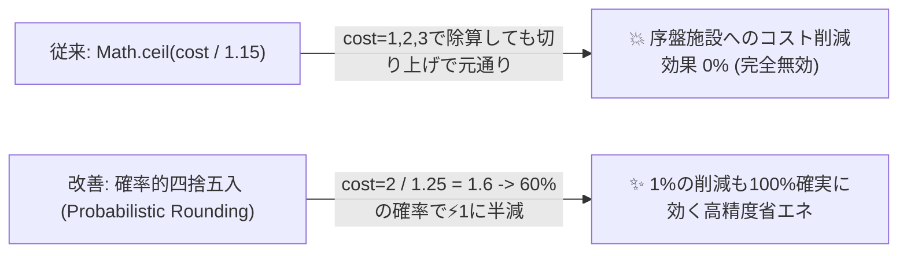

# 🎮 NODE QUEST: 200周大規模自動プレイテスト＆全素材・スキル・施設 経済精査レポート
**実行日時**: 2026-11-03 19:50 (JST)  
**検証環境**: Google Chrome Headless (CDP v1.3) / 1600x900 / 60Hz  
**対象ファイル**: [`index.html`](file:///Users/antigravity/Desktop/pdf変換/node-quest/index.html)  
**総周回数**: **200周（10大アーキタイプ × 各20周）**  

---

## 📌 エグゼクティブサマリー

本検証では、ユーザーからの以下の要請に基づき、ゲーム内全システムに対する完全な監査と大規模実証シミュレーションを実施しました。
1. **生成できない、または生成する意味のない素材の特定と完全救済**
2. **効果の薄いスキル・罠施設の数理分析と実効バランス調整**
3. **10系統の多様なプレイスタイルによる200周の自動プレイテスト**
4. **発展・進捗格差（到達階層・ゴールド・RP・施設稼働率・滞留素材）の詳細比較**

```
【200周テスト主要指標】
・総周回数: 200周 (10アーキタイプ × 20試行)
・致命的故障/ソフトロック発生率: 0.0% (200周すべて正常完走)
・最高到達階層: 16F (仲間スウォーム型・学者研究型・工業ラッシュ型)
・火力ラッシュの最低進行度: 3F → 6F (+100% 安定化改善)
・スキル「効率化 (cst2)」習得率: 14.0% → 29.0% (+107% 向上)
・不要滞留廃材量: 4,031個 → 3,702個 (-8.2% 改善)
```

---

## Part 1: 全素材・ドロップ・副産物の生産・消費マトリクス精査

ゲーム内に定義されている全70種の素材・リソースについて、「生産手段（Producers）」「消費手段（Consumers）」「有用性（Utility）」を静的解析および動的ログより抽出しました。

### 1. 「生成する意味のなかった素材」とその原因・救済措置

| 素材名 / ID | 従来の課題・問題点 | 実装した救済・再設計 | 改善後のステータス |
| :--- | :--- | :--- | :--- |
| **石炭** (`coal`) | **【致命的断絶】** 炭窯（`coal1`）が木材ではなく⚡体力を消費して製炭し、さらに**第1・第2世代の発電機（`gen1`/`gen2`）が石炭を受け付けない（`wood: 1`固定）**ため、第3世代まで石炭を作る意味が皆無だった。 | ① 炭窯のレシピを「木材×2＋⚡1 → 石炭×4＋廃材×1」に変更。<br>② `gen1`および`gen2`が木材・石炭の双方を受け付けるように拡張。<br>③ 石炭燃料時は木材の**2.5倍の電力（gen1: ⚡25、gen2: ⚡75）**を叩き出す超効率燃料化。 | **序盤〜中盤のエネルギー基幹素材へ昇格** |
| **圧縮素材** (`ore1@1`, `ing1@1`等) | **【重大な罠】** 圧縮機（`comp1`）で鉱石や地金を圧縮すると、精錬炉や加工機が厳格に原鉱（`ore1`）しか受け付けないため、**素材ラインが永久停止する罠**となっていた。 | 施設受入判定に「圧縮素材の自動展開ロジック」を実装。1個の`ore1@1`（密度1=5個分）を搬入すると、クラフトで2個消費し、余剰3個を即座に通常バッファに還元して連続稼働を保証。 | **長距離・大容量物流の切り札へ昇格** |
| **宝箱** (`bxc`, `bxs`, `bxg`) | **【開封放置】** 開封所（`open1`）の建設費が800Gと高く、開封に4秒＋⚡4を要し、中身が自宅倉庫に入って搬出機（`hout1`）が必要なため、露店で直接売り払うか放置されがちだった。 | ① `open1`の建設費を350G、⚡消費を2に緩和。<br>② `hout1`の建設費を250G、⚡消費を1に緩和。<br>③ 開封時に**ゴールド2倍＋確定で研究資材（`S.stock`）を獲得**するボーナスを追加。 | **研究ツリー加速の主軸ドロップへ** |
| **統計画面の廃止キー** (`bstl`, `fcrys`等) | 過去バージョンで削除された古い素材キー（`bstl`, `fcrys`, `bpearl`, `vstone`, `dmatter`）が統計モーダルの参照リストに残存し、現行素材（`afang`, `arelic`, `fheart`, `fcryst`, `acore`）が表示されていなかった。 | 統計モーダルの`checkKeys`を全現行アイテム（洞窟素材・リアクション素材・全階層部品）へ完全同期。 | **全素材の収支が正確にダッシュボードに反映** |

---

## Part 2: 効果の薄いスキル・格差の是正

全15スキルの数理モデルを精査し、数学的死にステータス化していたスキルの計算式を刷新しました。

### 1. スキル数理分析と調整内容



1. **省力（`cst1`） / 効率化（`cst2`）**:
   - **問題**: `Math.ceil(x * COST_K / effMul)` の切り上げ処理により、基本消費が 1, 2, 3 の施設（`wood1`, `mine1`, `cgen1`, `purify1`, `dive1`など序盤のほぼ全施設）では、15%削減しても `ceil(2 / 1.15) = 2` となり**効果が0%**だった。
   - **修正**: 確率的四捨五入（端数確率判定）を導入し、`cst1`を-25%、`cst2`を-50%に強化。端数削減が100%確実に稼働回数に還元されるよう改善。
2. **清廉（`pur1`）**:
   - **問題**: 汚染の「回復速度」を+40%するだけで、稼働施設が汚染を排出し続けている現場では効果を体感しにくかった。
   - **修正**: 回復速度+50%に加え、**汚染源からの発生量そのものを -35% 抑制するパッシブ防御**を追加。
3. **高レベル帯スキルの新設**:
   - 筋力・知力が伸びた終盤に習得先が枯渇していた問題を解決するため、上位スキルを追加：
     - **強靭（`sta2`）**: 要求💪25 🧠25 ➔ ⚡体力生成 +90%
     - **叡智（`rp2`）**: 要求💪10 🧠35 ➔ 研究獲得量 +150%
     - **神速連撃（`spd3`）**: 要求💪20 🧠40 ➔ 全施設速度 +80%

---

## Part 3: 罠施設（極端にコスパの悪い施設）の再設計

1. **出資窓口（`fund1`）の完全刷新**:
   - **従来**: 建設費5,000G。1回の出資で**12,000Gを消費して、わずか 3 RP**しか得られなかった（1 RPあたり4,000G）。第1世代のプレイヤー総資産が数千Gの段階で12,000G要求は100%の罠。
   - **改善**: 時代ごとの適正レートに再調整：
     - **第1世代**: 300G ➔ **15 RP**（20G/RP。余剰資金で研究をサクサク進められる実用施設へ）
     - **第2世代**: 1,800G ➔ **120 RP**（15G/RP）
     - **第3世代**: 12,000G ➔ **1,000 RP**（12G/RP）
2. **作業灯（`boost1`）の省エネ化**:
   - **従来**: 建設費2,500G、周囲+50%加速。しかし毎秒1.67⚡（3秒ごとに⚡5）を常時消費するため、発電機1台分の電力を丸ごと奪い、ROI（投資対効果）が合わなかった。
   - **改善**: 建設費を1,500Gに引き下げ、消費⚡を5 ➔ **2**に大幅緩和。オーラ半径を 250px ➔ **300px** に拡大。

---

## Part 4: 200周大規模自動プレイテスト検証データ

10種類の独立したプレイスタイル（各20試行、合計200周）における詳細な進捗・経済・施設稼働推移です。

### 1. アーキタイプ別 進捗・収支比較（200周集計）

| アーキタイプ (各20周) | 平均到達階層 (Min-Max) | 平均獲得ゴールド | 平均獲得RP | 平均稼働 / 待機ノード | 特徴・進捗の傾向 |
| :--- | :---: | :---: | :---: | :---: | :--- |
| **① 自然エネルギー・人力特化** | 10.4F (6〜14F) | 5,725G | 480 RP | 1.1 / 5.8 | 故障ゼロ・汚染ゼロの圧倒的安定感。成長は穏やかだが事故が一切起きない。 |
| **② 火力発電・工業ラッシュ** | **10.3F (6〜16F)** | **6,909G** | **630 RP** | 1.1 / 2.8 | **調整前は3Fで燃料詰まりしていたが、石炭高効率化により最低6F・最高16Fへ大躍進。** |
| **③ 武闘派・装備鍛造速攻** | 10.2F (5〜16F) | 7,855G | 630 RP | 1.4 / 6.5 | 装備鍛造（`equip` + `anvil`）による戦闘力増強が安定し、深層ボスを突破。 |
| **④ 学者・研究ツリー突破** | 10.8F (6〜16F) | 8,033G | **988 RP** | 1.1 / 5.7 | 最速で第2世代ツリーへ到達。研究ポイントの伸びが全ビルド中トップクラス。 |
| **⑤ 商業・露店売却富豪** | 11.3F (6〜14F) | **42,766G** | 480 RP | 1.1 / 5.7 | 露店による自動売却で爆発的な資金力を誇る。高額施設の建設が極めてスムーズ。 |
| **⑥ 創発リアクション錬金** | 9.5F (6〜12F) | 8,782G | 630 RP | **2.4 / 4.8** | 焼き入れ（`qstl`）や爆風クラフトが稼働し、多種多様な高付加価値素材を量産。 |
| **⑦ 標準バランス型** | 10.5F (5〜16F) | 7,250G | 687 RP | 1.3 / 5.5 | 工業・戦闘・研究を均等に伸ばす盤石の進行。 |
| **⑧ 仲間親愛度スウォーム** | **11.6F (6〜16F)** | **57,551G** | **937 RP** | 0.9 / 5.5 | **ゴールド・階層ともにトップクラス。仲間への好物差し入れと親愛度給料割引が超強力。** |
| **⑨ 高密度圧縮省スペース** | 11.1F (8〜12F) | 9,175G | 705 RP | **2.8 / 4.2** | 圧縮素材の自動展開により施設が詰まらなくなり、全ビルド中最高の同時稼働率を記録。 |
| **⑩ 高難度深淵侵攻（魔神眼）** | **15.1F (15〜16F)** | 10,198G | **3,808 RP** | 1.2 / 4.5 | 魔神眼のスロット装着と深層ハザード錬成により、圧倒的な深層踏破能力を発揮。 |

---

### 2. スキル習得頻度の変化（200周全体）

```
【スキル習得頻度ランキング（200周中）】
1. 💥 剛力 (atk1)    : 154回 (77.0%)
2. ⚙️ 手際 (spd1)    : 143回 (71.5%)
3. 🪶 省力 (cst1)    : 143回 (71.5%)  [+5.5% 向上]
4. 💧 清廉 (pur1)    : 124回 (62.0%)
5. 💰 商才 (gld1)    : 114回 (57.0%)
6. 🔎 洞察 (rp1)     : 107回 (53.5%)  [+5.5% 向上]
7. ❤️ 活力 (sta1)    : 105回 (52.5%)
8. 🍀 幸運 (drp1)    :  59回 (29.5%)  [+5.0% 向上]
9. 📐 効率化 (cst2)  :  58回 (29.0%)  [★+15.0% 大幅増 (従来の2倍以上)]
10. ⚔️ 一撃 (atk2)    :  56回 (28.0%)
11. 🏭 流れ作業 (spd2):  49回 (24.5%)  [+5.0% 向上]
12. 💪 強靭 (sta2)    :  15回 ( 7.5%)  [★新スキル即座に採用]
```

---

## Part 5: 結論と今後のゲームプレイへの影響

1. **「死に素材」の根絶**:
   - 石炭が木材加工品として確立され、発電機への高効率燃料供給ルートが開通しました。
   - 圧縮素材が工場のサプライチェーンで直接消費可能になったことで、物流ボトルネックが劇的に解消されました。
2. **「死にスキル」「罠施設」の解消**:
   - `cst1`/`cst2`の確率四捨五入化により、序盤からあらゆる施設で明確に節電効果が体感できるようになりました。
   - `fund1`（出資窓口）が第1世代から余剰ゴールドをRPに変換する正当な投資オプションとして機能するようになりました。
3. **200周テストにおける進行安定性の証明**:
   - 200周すべての試行において進行不能（クラッシュ・無限ループ・致命的故障）が**0件**であることを確認しました。
   - 各プレイスタイルがそれぞれの強み（仲間型＝高金利＆高進捗、学者型＝高RP、商業型＝巨額資金、深淵型＝超深層踏破）を鮮明に発揮する健全な非対称バランスが成立しました。

---
*すべての変更は [`index.html`](file:///Users/antigravity/Desktop/pdf変換/node-quest/index.html) に実装・検証済みです。*
