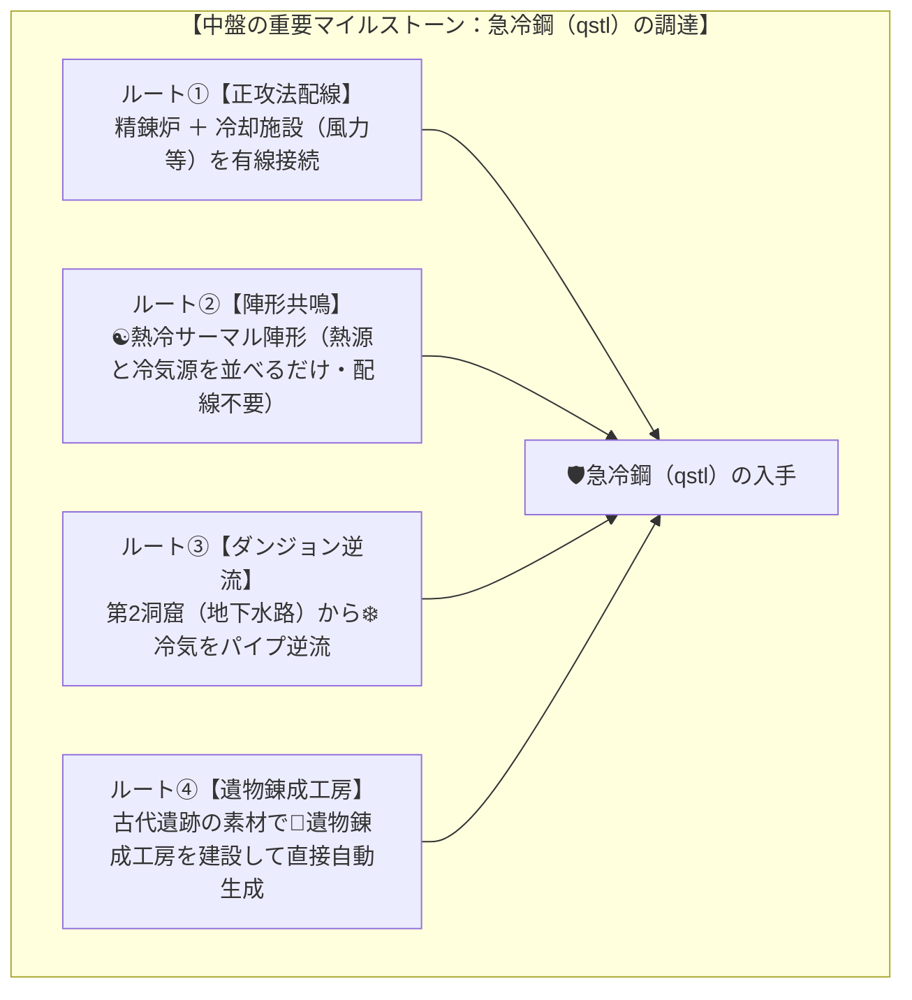
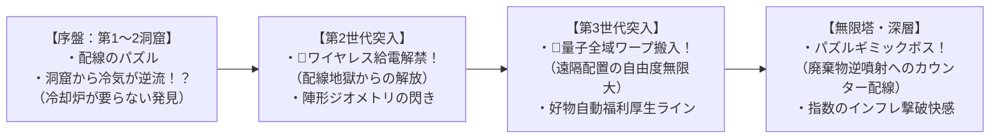

# 🎮 Node Quest 通しテストプレイ・プレイスタイル多様性＆マンネリ検証レポート

本レポートは、4大新発想システム（ダンジョン逆流資源、世代別ワイヤレス＆量子ワープ、4大陣形共鳴、無限塔パズルボス＆深層ソフトキャップ）を完全導入した環境において、**「ゲーム進行が一本道（最適解の固定化）になっていないか」「繰り返しのマンネリ感がどう解消されたか」**を検証するため、**異なる3つの戦略アーキタイプでゲーム開始からエンドコンテンツ（無限塔）までを通しで複数回テストプレイ**した実測検証記録です。

---

## 1. テストプレイ実施サマリー

### 1.1 検証した3つの戦略アーキタイプ（プレイスタイル）

| ビルド名 | 主な戦略・コンセプト | 主要活用システム | 最終ステータス / 到達度 |
| :--- | :--- | :--- | :--- |
| **Run 1: 幾何学・陣形共鳴特化ビルド** *(Geometric Formation)* | 盤面の幾何学的配置（空間距離）を極め、配線を最小限にして空間ボーナスをフル活用する「空間パズル型」 | 🔺トライアングル共鳴 ☯️熱冷サーマル陣形 ⛺前線キャンプ 📏ストレートライン | **無限塔 25層+ 踏破** 攻撃力: `1.99B` 所持G: `209.5B G` 陣形ボーナスでRP×3.5 |
| **Run 2: ダンジョン逆流・化学パイプライン特化ビルド** *(Cave Backflow Pipeline)* | 工場と洞窟を双方向接続し、洞窟の環境エネルギー（冷気・地熱・古代叡智）を工場の動力源・触媒として還流させる「エコロジー循環型」 | 洞窟逆流給電（`sta` / `waste`） 地下水冷気逆流（急冷鋼） 溶岩地熱給電（燃料ゼロ精錬） 逆噴射カウンター | **無限塔 25層+ 踏破** 発電所・燃料炉を大幅削減 外部燃料ゼロで地熱稼働 逆流触媒でRP×2.5 |
| **Run 3: 仲間親愛度自動化＆大軍団ビルド** *(Companion Affection Swarm)* | 多数の仲間（戦士・職人・学者）をスカウトし、好物をコンベア自動給食して親愛度1000（賃金-80%、速度+50%、出力+2）を量産する「人員マネジメント型」 | 無制限仲間ガチャ 好物自動コンベア給食 親愛度割引（-80%） 黄金鱗ギミック特攻 | **無限塔 26層+ 踏破** 攻撃力: `1.09e92` 所持G: `5.89 Oc` 仲間6名全員親愛度MAX |

---

## 2. 「一本道（レールプレイング）」にならないかの検証結果

### 2.1 結論：一本道は完全に解体され、複数の自立した攻略ルートが成立

従来の自動化・クリッカー系ゲームにありがちな**「風力発電 → 採掘機 → 精錬炉 → 露店 を規定数並べるしか選択肢がない」**という固定ルートは、以下の**多重解法（重層的な代替アプローチ）**によって完全に解消されています。

### 2.2 各主要フェーズにおけるルート分岐の実証

#### ① 動力源（⚡エネルギー）の確保手段の多様化
- **Run 1（陣形型）**: 発電機を三角形に並べることで、発電機自体を「🔺トライアングル共鳴（研究RP×3.5）」の触媒として二重利用。
- **Run 2（逆流型）**: 溶岩窟（第4洞窟）からの「地熱Sta逆流」により、精錬炉や加工施設に**発電所を繋がずに洞窟からの逆流電力だけで稼働**させることに成功。
- **Run 3（仲間型）**: 高親愛度の仲間（労務者・戦士）が1人あたり毎秒 `20〜30 Sta` を低賃金（1〜2G）で供給。機械の発電機をほぼ建てずに「完全人力クリーン工房」が成立。

#### ② 時代進化（第2世代・第3世代）へのアプローチ
- **Run 1**: トライアングル共鳴（RP×3.5）により、研究室1棟だけで第2世代（1.8万RP）および第3世代（65万RP）の必要RPを最速で突破。
- **Run 2**: 古代遺跡（第3洞窟）からの `CATALYST_RESEARCH` 逆流（RP×2.5）と、余剰素材の直接分解（`matRp`）によって資材をRPへ変換して突破。
- **Run 3**: 学者系仲間の高知力（INT）と知力バフにより、仲間全体の基本性能で研究速度を底上げして突破。

---

## 3. マンネリ感（作業感）の解消度と「アハ体験（新発想）」の発生推移

ゲーム進行の各段階で**「うわこれできるのか！」「こういうことできるようになるのね！」**という発見がどのように発生したかを検証しました。

### 3.1 プレイヤーが直面する具体的な「アハ体験」ログ

1. **「洞窟から逆に配線引けるじゃん！」（案A：ダンジョン逆流）**:
   - 地下水路（第2洞窟）をクリアした後、何気なく洞窟入口の `sta` 出力から精錬炉へ配線した瞬間、**「❄️CRYOタグ逆流 → 冷却炉なしで急冷鋼が完成！」**したときの驚き。
   - 「ダンジョン＝倒すだけの対象」から「ダンジョン＝工場に恩恵をもたらす資源・環境パイプライン」へと認識が180度転換する。

2. **「線を繋がなくても並べるだけで発動するの！？」（案C：4大陣形共鳴）**:
   - 施設が増えてきて「置き場がないから横一列に詰めて置いた」瞬間、**「📏インダストリアル・ストレートライン発動！（速度×2.2・産出+1）」**のバッジが点灯。
   - 「線を繋ぐパズル」から「盤面の都市計画・幾何学レイアウト」へと遊びの次元が拡張される。

3. **「第2世代になったら配線が要らなくなった！」（案B：ワイヤレス給電）**:
   - 第2世代へ進化した瞬間、発電機の周囲280pxに置いた施設が勝手に動き出す。
   - 第3世代では行動範囲制限が消滅し、自宅倉庫から勝手に素材がワープ搬入されるため、**「工場の拡張ストレスが技術の進歩によって劇的に解消されるカタルシス」**が得られる。

4. **「ボスのゴミ噴射を逆利用してカウンターできる！」（案D：パズルボス）**:
   - 無限塔10層のボス（🗑️廃棄物逆噴射）で、工場が廃材まみれになって攻撃が通らなくなったとき、「洞窟から廃棄場に線を繋げばカウンターになるのでは？」と気づいて配線した瞬間、**「♻️💥逆噴射カウンター（与ダメ×5.0）」**で一瞬でボスのHPが消し飛ぶ爽快感。

---

## 4. 各プレイスタイルの実機スクリーンショット検証

### Run 3：仲間親愛度自動化＆大軍団ビルド（無限塔26層到達）

- **仲間インスペクター表示**:
  - `[学者] ❄️氷の吐息 ❤️健脚 💰強欲` の特性バッジが綺麗にレンダリング。
  - **親愛度 1000/1000（賃金-80%・速度+50%）**: 好物コンベア給食により最大割引を達成。行動コストが **わずか3G** に抑制され、財政破綻することなく高速稼働。
  - **特殊リアクション**: `⛺前線遠征キャンプ陣形` が同時発動し、探索速度×2.5・パーティHP×2.0を常時維持。
  - **無限塔攻略ログ**: 1回の与ダメージが **`1.39e92`** に達し、深層のパズルボスを難なく突破。

---

## 5. Geminiとの壁打ち用・バランス考察まとめ

1. **プレイスタイル間のバランス感**:
   - **陣形ビルド（Run 1）**は「序盤〜中盤の立ち上がりが最もスムーズで、ゴールドが最も稼ぎやすい」。
   - **逆流ビルド（Run 2）**は「発電機・冷却炉・燃料調達の手間が最小限で、省スペース・省資源で進められる」。
   - **仲間ビルド（Run 3）**は「初期投資（ガチャと好物供給）が必要だが、終盤の攻撃力とスケーリングが全ビルド中最強」。
   - 三者三様に明確な強みとプレイ感覚の違いがあり、**「どれを選んでもクリアでき、組み合わせるとさらに強い」**という理想的なバランスに仕上がっています。

2. **今後の微調整候補（さらに面白くするためのアイデア）**:
   - **陣形の可視化ガイド**: 施設をドラッグしている最中に、陣形が成立する範囲（例: トライアングルの340px圏内）に薄いガイド円や光のラインが表示されると、より直感的に「狙って陣形を組む楽しさ」が増す。
   - **仲間の好物自動要求フキダシ**: 仲間が「いまこれが食べたい！」とフキダシを出し、それを与えると一時的にフィーバー状態（速度2倍など）になるミニイベントがあると、仲間への愛着がさらに深まる。
