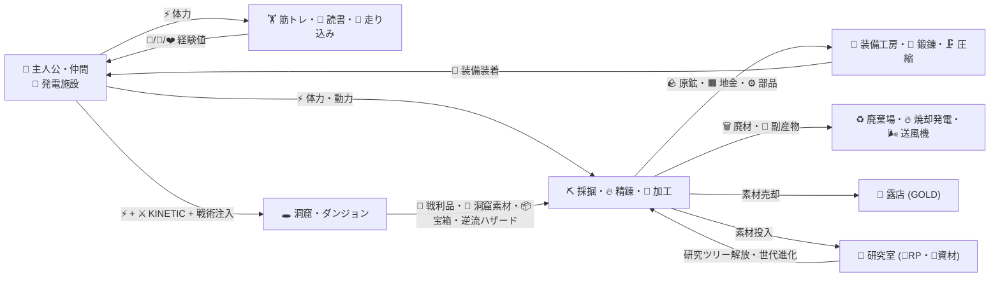
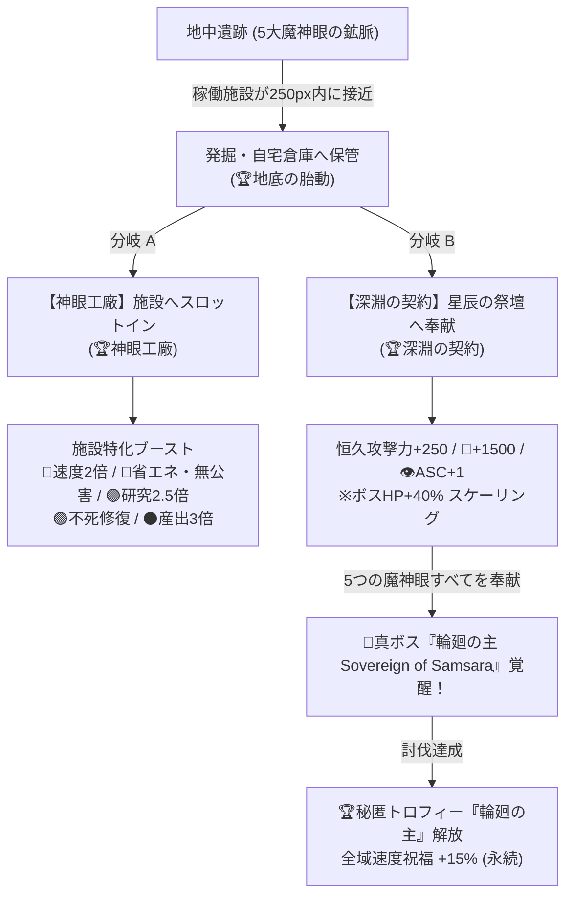

# NODE QUEST 完全仕様書 ＆ ゲームバランス全データ集

本ドキュメントは、現行の [index.html](file:///Users/antigravity/Desktop/pdf変換/node-quest/index.html)（全11,746行・単一HTML構成）の実装から抽出した**完全なシステム仕様・計算式・全マスターデータ・バランス調整パラメータ**の網羅的リファレンスです。そのままAIとの壁打ちやバランス検証に利用できます。

---

## 1. 現状の全体像とアーキテクチャ

### 1.1 プロジェクト構成
- **ファイル構成**: 外部ライブラリ依存ゼロの単一ファイル [index.html](file:///Users/antigravity/Desktop/pdf変換/node-quest/index.html)（HTML + CSS + Vanilla JS / SVG + DOM）
- **セーブ仕様**:
  - 本体セーブ: `localStorage` キー `nodequest`（5秒ごと自動保存 + タブ非表示・終了時保存、Base64引き継ぎコード対応）
  - トロフィー記録: `localStorage` キー `nodequest2.trophy`（本体リセット時も永続保持）
  - 開発ツール設定: `localStorage` キー `nodequest2.devcfg`（研究ツリー・施設性能・初期配置・定数オーバーライドを保存）
- **内蔵デバッグ・開発機能**:
  - **ゲーム開発ツール (`#devTool`)**: メニューからいつでも起動可能。研究ツリーGUI編集、施設の追加・入出力編集、初期盤面キャプチャ、定数変更、サンドボックス操作、創発リアクション検証プリセット（A〜D）を搭載。
  - **デバッグモード (`?debug=1` / `#debug`)**: 全ノード強制設置・速度スライダー（×1.0〜×5.0）等。通常画面上部にも「⏩ ×1 / ×2 / ×3 / ×5」切替ボタンあり。

### 1.2 初期版（README記載時点）からの主な進化点
[README.md](file:///Users/antigravity/Desktop/pdf変換/node-quest/README.md) 記載の初期仕様から、以下の大型システムが追加・改修されています。
1. **創発リアクションエンジン（Reaction Engine）**: 配線を流れるアイテム・動力の属性タグ（`HEAT`, `CRYO`, `POLLUTION`, `SHOCKWAVE` 等11種）の掛け合わせで、焼き入れ・爆風クラフト・共鳴ループ・戦場介入・逆流ハザード精製など14種の化学反応が発生。
2. **マルチ洞窟＆エンドコンテンツ「無限塔」**: 単一ダンジョンから、階層上限と初回10倍クリア報酬・固有素材ドロップを持つ6つの洞窟＋「無限塔」の計7ステージ制へ拡張。
3. **パーティLP・HP・丸腰敗北チェック（Gear Check）**: 未装備（素手）状態では敵装甲に弾かれて1ダメージとなり、反撃でHP0 → LP減少。LPが0になると探索と人タイプ（主人公・仲間）の⚡供給が完全停止するリスク管理要素。
4. **素材別施設クラフト（`craftMat`）＆洞窟素材専用施設**: 建設時に使用する地金・合金・洞窟素材・圧縮素材を選択でき、施設の速度・産出量・省エネ・スロット枠・無廃・属性タグが変化。また洞窟ドロップ素材で建てる4系統の特殊施設（魔獣抽出炉・戦術支援砲台・遺物錬成工房・星辰の祭壇）を追加。
5. **人タイプ別の個別ステータス＆給料・行動範囲制限**: 仲間（村人・職人・研究者）も個別に筋力・知力・体力を持ち、行動ごとにゴールド（給料）を消費。人から⚡を送る場合は半径 `380px + 補正` の行動範囲円内に施設を置く制約。
6. **クリーン発電 vs 稼働汚染・汚染爆発**: 人と風力等のクリーン発電以外は稼働だけで周囲を汚染し、汚染80%以上で確率爆発・施設消滅（それを逆手に取る「爆風クラフト」「ブラストキャノン」も存在）。
7. **周囲浸食・吸収合体（`assim` / メガ施設・キメラ施設）**: 半径260px以内の施設を最大8台まで吸収合体し、省スペースで出力倍率・速度・自家発電・属性タグを統合するシステム。
8. **スマホUI・X-Rayデータレンズ・モンスター図鑑**: Normal / Logistics / Power / Hazard の4種レンズ切替と、全35種モンスターの弱点・耐性・ドロップを記録する図鑑機能。
9. **無制限仲間ガチャ・継続賃金・親愛度・好物差し入れシステム**:
   - 従来の固定3名（村人・職人・研究者）から、人数上限無制限の**ランダム仲間ガチャ（酒場スカウト）＆待機所（Roster）**へ完全刷新。
   - 仲間は独自のロール・二つ名・3値ステータス・長所/欠点特性・大好物を持ち、人タイプ施設ノードとして盤面に自由配置・待機所へ温存撤退が可能。
   - **継続賃金＆ストライキ**: ⚡出力ごとにゴールドを消費。資金不足でストライキ（`isStrike`）に突入し、⚡出力・ステータス支援・タグ出力が全面停止。
   - **親愛度（Affection `0〜1000`）**: コンベア経由の好物搬入や賄い支給で親愛度が上昇し、**賃金が最大 -80% 割引**、作業速度最大 +50%、⚡出力・行動範囲が拡大。盤面からコンベアで好物を流し込む「自動福利厚生ライン」を構築可能。

---

## 2. コアゲームループと基本メカニクス



### 2.1 初期状態（ニューゲーム開始時）
- **初期リソース**: ゴールド `500 G`、研究ポイント `30 RP`、研究資材 `25 🧱`、自宅在庫なし
- **初期盤面ノード**:
  - `#1 🧍主人公` `(x:80, y:150)`: 初期から `🎽銅の装備 (eqp1)` をスロット1に装着済み、出力バッファに `⚡2` チャージ済み
  - `#2 🕳️洞窟の入口 (dive1)` `(x:420, y:150)`: 主人公から `⚡sta` 配線が1本接続済み
- **初期解放済み施設（Era 1 `start: true`）**:
  - `🧍主人公 (hero)`（固有1体）、`🕳️洞窟の入口 (dive1)`、`🏪露店 (shop1)`、`⛏️採掘機 (mine1)`、`♻️廃棄場 (dump1)`、`🔬研究室 (lab1)`、`🍃風力発電機 (cgen1)`

### 2.2 人の行動範囲と動力ルール
- **人タイプ (`src: true`)**: 主人公 (`hero`) およびスカウトした無制限の仲間ノード（`companionRoster`）。
- **行動範囲制限**: 人タイプから `⚡sta` を配線して施設を動かす場合、送り先施設が**人の行動範囲内**になければ稼働しない（範囲外は配線に `🚫 距離外` が表示され無効化）。
  $$\text{HumanRange}(n) = \max\Bigl(180,\ 380 + \min\bigl(240,\ \text{VIT}_n \times 10 + \text{STR}_n \times 5\bigr) + \sum \text{trait.rangeAdd} + \lfloor \text{Affection}_n / 10 \rfloor\Bigr) \quad [\text{px}]$$
  ※ 親愛度1000で最大 `+100px`、特性（快足 `+60px` / 出不精 `-60px`）等により伸縮。
- **発電機 (`gen` / `cgen` / `fuel`)**: 行動範囲（距離制限）なしでどこへでも送電可能。
- **世代別の追加動力 (`ERA_POW`)**:
  - 生産・加工・販売系ロール（`ore`, `ingot`, `part`, `alloy`, `atk`, `anvil`, `comp`, `decomp`, `sell`, `tool`, `equip`）は、施設の世代が上がると `⚡sta` に加えて上位電力が必要になる。
  - **第1世代（黎明）**: `⚡sta` のみ
  - **第2世代（高圧）**: `⚡sta` ＋ `🔋高圧電力 (power) × 1`（導電装備で軽減可）
  - **第3世代（超臨界）**: `⚡sta` ＋ `🔋高圧電力 (power) × 2` ＋ `🌀臨界電力 (nfl) × 1`

### 2.3 コンベア物流とパケット仕様
- すべての動力・経験値（オーブ表示）と物理素材（コンテナ表示）は、直交ステップ配線上をパケットとして移動し、**到着時に入力バッファ `inBuf` に加算**される（`fast` 処理時やレイヤーポート・上限420個超過時は即時転送）。
- **コンベア定数**:
  - 基準速度 `PSPEED = 72 px/s`
  - 移動時間クランプ: 最短 `PMIN = 1.4秒` 〜 最長 `PMAX = 3.6秒`
  - 送出クールダウン: 通常 `SENDCD = 0.28秒`（レイヤー口は `0.10秒`）
  - バッチ束ねルール: 出力バッファ在庫が `12個以下` なら必ず `1個＝1パケット` で送出。`13個以上` の場合は $\lceil \text{bufNow} / 8 \rceil$ 個ずつ束ねて `×q` バッジ付きで送出。
  - ベルト容量: $\text{beltCap}(l) = \text{clamp}(\lfloor \text{length} / 30 \rfloor, 4, 20)$、車間ギャップ $\text{beltGap}(l) = \min(0.24, 34 / \max(96, \text{length}))$。
  - 送り先バッファが満杯のときは先頭パケットが `t = 0.94` で停止し、後続パケットが数珠つなぎに詰まる（Jam状態）。
- **分配優先度 (`prio`)**:
  - 各ノードに `1〜9`（初期値 `1`）の優先度を設定でき、重み付きラウンドロビン（複合施設は段数倍、レイヤーは内部利用者数倍の重み）で配分される。

### 2.4 ノードへのアイテム供給・物資投入方式（4方式）
プレイヤーが盤面の各ノードにアイテム・素材を流し込む、または装着する手段は以下の4系統に分類されます。

1. **ベルトコンベアによる自動搬入（配線物流）**:
   - 出力ノードの右側ポート（`pout`）から入力ノードの左側ポート（`pin`）へドラッグまたはタップで接続。
   - 一般生産施設は `ins` に定義された必要素材を受け入れ、貯蔵庫・売り場はスロット割り当てにより複数素材を受け入れ。
   - **仲間ノードの「＋ 🎁好物/物資」受入口**: 仲間ノードは任意の非エネルギー素材を受け入れる万能スロット（`softIns`）を持ち、コンベアで好物や素材を搬入すると自動消費して親愛度と能力値が上昇。
2. **搬出機（`hout`）による自宅倉庫アイテムの盤面供給**:
   - 開封所で宝箱を開けて自宅倉庫に格納された素材・洞窟ドロップ品を、搬出機から盤面へ流し出して自動化ラインへ投入。
3. **インスペクタ（詳細パネル）からの手動セット**:
   - **🎽 装備スロット**: 主人公・仲間ノードを選択し、装備工房で製作した装備品を装着。
   - **⚙️ 強化パーツスロット**: 施設ノードを選択し、ダンジョンで拾った加速・増産などのパーツを装着。
   - **🛠️ クラフト素材換装**: 施設ノードの材質（銅・鉄・強化鋼・洞窟素材等）を手持ち素材を消費して換装。
   - **🎁 好物・🍖 賄い手動支給**: 仲間ノードを選択し、自宅の好物やゴールドを消費して直接差し入れ（即時ストライキ解除＋親愛度上昇）。
4. **コード拡張によるノード入出力定義（開発・MOD仕様）**:
   - `ITEMS` に新規アイテム定義、`TYPES[type].ins / outs` に固定入出力定義、または `softIns(n)` に動的受入スロットを定義。

---

## 3. 全数学モデル・ゲームバランス計算式

### 3.1 グローバル成長曲線 (`CURVE`)
スクリプト冒頭 [`CURVE`](file:///Users/antigravity/Desktop/pdf変換/node-quest/index.html#L1457-L1477) でゲーム全体の進行速度・訓練の重さ・敵HPスケーリングを一括制御しています。

| 定数名 | 現行値 | 派生変数と計算式 | 役割・バランスへの影響 |
| :--- | :---: | :--- | :--- |
| `CURVE.index` | `120` | $\text{COST\_K} = \frac{100}{\text{index}} = 0.8333$ | すべての施設の `⚡sta` 消費量に掛かる倍率。大きいほど全体的に軽くなり進行が速まる |
| `CURVE.taper` | `100` | $\text{TRAIN\_K} = 1 + 0.03 \times \frac{\text{taper}}{100} = 1.03$ | 訓練の⚡コスト底。能力値が上がるほど指数的に訓練が重くなる |
| `CURVE.depth` | `260` | $\text{ENEMY\_K} = 1 + 0.26 \times \frac{100}{\text{depth}} = 1.10$ | 実効階層（`effFloor`）1層あたりの敵HP成長率（現行は1層ごとに `+10%`） |

### 3.2 施設レベル強化と逓減曲線 (`lvPow`)
- **強化コスト (`upCost`)**:
  $$\text{upCost}(n) = \lfloor T.\text{up} \times (\text{UP\_K})^{L - 1} \rfloor \quad (\text{標準 } \text{UP\_K} = 1.02,\ \text{レイヤー出口のみ } \text{upk} = 1.55)$$
  ※ 基本強化費 $T.\text{up} = \max(1, \text{round}(\text{baseCost} \times 0.03 \times 18^{\text{era}-1}))$
- **レベル倍率 (`lvPow`)**:
  - 定数: `ERA_SPD = 0.30`（1世代あたりの速度比 $1/0.30 \approx 3.333\text{倍}$）、`LV_STEP = 5`、`LV_BASE = 12.25`
  $$\text{lvGen}(L) = \frac{\ln\bigl(1 + \frac{\max(1, L) - 1}{12.25}\bigr)}{\ln(5)}$$
  $$\text{lvPow}(L) = \left(\frac{1}{0.30}\right)^{\text{lvGen}(L)} \approx 3.333^{\text{lvGen}(L)}$$
  - **設計意図**: レベル強化は対数的に逓減し、**Lv.50 でちょうど1世代上（$\text{lvGen}=1 \Rightarrow \times 3.33$）**、**Lv.246 で2世代上（$\text{lvGen}=2 \Rightarrow \times 11.11$）**に追いつく設計。「世代進化は研究（RP＋資材）、個別施設の底上げはゴールド」という役割分担になっている。

| 施設 Lv | `lvGen(L)` (世代換算) | `lvPow(L)` (速度・出力倍率) | 備考 |
| :---: | :---: | :---: | :--- |
| Lv.1 | 0.00世代 | ×1.00 | 初期状態 |
| Lv.10 | 0.34世代 | ×1.51 | 序盤の安価な強化 |
| Lv.25 | 0.67世代 | ×2.25 | 中盤の主力強化ライン |
| Lv.50 | 1.00世代 | ×3.33 | **次世代のLv.1施設と同等の速度に到達** |
| Lv.100 | 1.37世代 | ×5.20 | |
| Lv.246 | 2.00世代 | ×11.11 | **2世代先のLv.1施設と同等の速度に到達** |

### 3.3 人タイプの能力値（STR / INT / VIT）と訓練曲線
主人公 (`hero`) と各仲間 (`mate1..3`) は**個体ごとに独立した能力値 (`stats`) と経験値 (`exp`)** を持ちます。

- **訓練1回あたりの必要⚡コスト倍率 (`trainMul`)**:
  $$\text{trainMul}(\text{lv}) = (\text{TRAIN\_K})^{\text{lv}^{\text{TRAIN\_P}}} = 1.03^{\text{lv}^{1.55}}$$
  ※ 訓練施設が接続している送り先の人タイプ（未接続時は主人公）の該当能力値 `lv` を参照。
- **能力値1アップに必要な経験値 (`expNeed`)**:
  $$\text{expNeed}(\text{lv}) = 1 + \lfloor \text{lv} / 2 \rfloor \quad (\text{EXP\_STEP} = 2)$$
- **訓練施設の1回あたり経験値産出量 (`trainYield`)**:
  $$\text{trainYield}(n) = 1 + \lfloor (n.\text{level} - 1) / 20 \rfloor$$

| 能力値 `lv` | `trainMul(lv)` (訓練⚡倍率) | `expNeed(lv)` (必要経験値) | 1レベル上げる実質⚡重み比 |
| :---: | :---: | :---: | :---: |
| 0 | ×1.00 | 1 | 1.0 |
| 5 | ×1.43 | 3 | 4.3 |
| 10 | ×2.86 | 6 | 17.2 |
| 15 | ×7.17 | 8 | 57.4 |
| 20 | ×21.6 | 11 | 238 |
| 30 | ×326 | 16 | 5,216 |
| 50 | ×346,000 | 26 | 約900万 |
| 70 | ×2.62×10⁹ | 36 | 約943億 |

- **各能力値の効果**:
  - **❤️ 体力 (`VIT`)**:
    - その人タイプの⚡最大保持上限: $\text{maxStaOf}(n) = \lfloor 12 \times 1.065^{\text{VIT}_n} \rfloor$
    - その人タイプの⚡生成周期: $\text{staRate}(n) = \frac{T.\text{time}}{1.065^{\text{VIT}_n} \times \text{lvPow}(n.\text{level}) \times (1 + (\text{era}-1)\times 0.5)}$
    - 行動範囲半径: $+10\text{px} / \text{VIT}$
    - パーティ最大HP（主人公のVIT）: $+35\text{ HP} / \text{VIT}$
  - **💪 筋力 (`STR`)**:
    - 全体筋力合計 $\text{totalStr} = \text{STR}_{\text{hero}} + \sum_{\text{稼働中の仲間}} \text{STR}_{\text{mate}}$
    - 攻撃力乗数: $1 + 0.15 \times \text{totalStr}$
    - 人から⚡供給を受けている施設の作業速度ボーナス: $+2\% / \text{STR}$
    - 行動範囲半径: $+5\text{px} / \text{STR}$
  - **🧠 知力 (`INT`)**:
    - 全体知力合計 $\text{totalInt} = \text{INT}_{\text{hero}} + \sum_{\text{稼働中の仲間}} \text{INT}_{\text{mate}}$
    - 全施設の作業速度乗数 (`intBoost`): $1 + 0.02 \times \text{totalInt}$
    - 研究所のRP獲得乗数: $1 + 0.15 \times \text{totalInt}$
    - 人から⚡供給を受けている施設の作業速度ボーナス: $+3\% / \text{INT}$

### 3.4 作業時間（`craftTime`）と⚡消費量（`staCost`）
- **施設の1回あたり所要時間 (`craftTime`)**:
  - **人タイプ (`src: true`)**:
    $$\text{craftTime}(n) = \frac{\text{staRate}(n) \times \text{mods.spd} \times \text{env}}{\text{skillMul('sta')} \times \text{troMul}() \times \text{rxSpeedMul}(n)}$$
  - **一般施設**:
    $$\text{craftTime}(n) = \frac{\text{baseTime} \times \text{mods.spd} \times \text{env}}{\text{lvPow}(n.\text{level}) \times \text{intBoost}() \times \text{humanBoostOf}(n) \times \text{skillMul('spd')} \times \text{troMul}() \times \text{rxSpeedMul}(n)}$$
  - ここで環境補正 $\text{env} = \frac{1 + n.\text{pol} \times 1.6}{n.\text{spd(オーラ加速)}}$、創発反応倍率 $\text{rxSpeedMul}(n)$ は過負荷・バーサーク時 $\times 4.0$、共鳴ループ時 $\times (1 + \min(4.0, \text{resLoop}\times 3.5))$、呪詛時 $\times 0.55$。
- **施設の1回あたり⚡消費量 (`staCost`)**:
  $$\text{staCost}(x, e) = \max\left(1,\ \left\lceil \frac{x \times e \times \text{COST\_K}}{\text{skillMul('cost')}} \right\rceil\right) \quad \left(e = 0.42^{\text{era}-1}\right)$$

### 3.5 経済・建設費・売却・出資・仲間ガチャ＆継続賃金
- **施設建設ゴールド (`buyCost`)**:
  $$\text{buyCost}(t) = \max\left(1,\ \left\lfloor \text{baseCost} \times (\text{FIRST割引}) \times (\text{pk})^c \right\rfloor\right)$$
  - 同種施設の設置台数 $c$ ごとに `PRICE_K = 1.28`（露店 `shop` のみ `pk = 2.4`）で指数上昇。
  - 1台目（$c=0$）はチュートリアル・序盤導線のため `FIRST` 割引あり：`dump: 0.35`, `shop/lab/box/smelt/forge/comp/fuel/purify/equip/anvil/boost: 0.5`, `cgen/tstr/tint/tvit: 0.6`（※採掘 `mine` のみ割引なし `60G`）。
- **施設建設の必要資材 (`buyMat`)**:
  - 第1世代の通常施設は**標準（素材未指定）ならゴールドのみで建設可能（資材不要）**。
  - 第2世代以降、または任意のクラフト素材を指定した場合は、基本地金個数 $\text{baseQ} = \max(1, \text{round}(\text{buyCost}(t) \times 0.045 / \text{itemVal}(\text{ing}_{\text{era}})))$ を価値比で換算した個数（1〜12個）を自宅・貯蔵から消費。
- **露店でのアイテム売値 (`sellPrice`)**:
  $$\text{sellPrice}(k, \text{lv}) = \max\left(1,\ \text{round}\bigl(\text{itemVal}(k) \times \text{SELL\_CLASS}(k) \times 200 \times \text{lvPow}(\text{lv}) \times \text{gearMul('rich')} \times \text{skillMul('gold')}\bigr)\right) \times \text{sellMul}(n)$$
  - `SELL_CLASS`: 原鉱 (`ore*`) = `0.5`、地金 (`ing*`) = `1.2`、部品 (`prt*`) = `1.8`、その他（戦利品・合金・装備・創発品・洞窟素材） = `1.0`。
  - 第2世代以降の売り場はパーク【目利き】により $\text{sellMul}(n) = 1.5$。
- **出資窓口 (`fund`: ゴールド → RP変換)**:
  - 1回あたりの消費ゴールド: $\text{fundGold}(n) = \text{round}(12000 \times 2.6^{\text{era}-1})$
  - 1回あたりの獲得RP: $\text{fundRp}(n) = \max(1,\ \frac{\text{fundGold}(n)}{4000} \times \text{lvPow}(n.\text{level}) \times \text{gearMul('arcane')})$（基準は `4,000G = 3 RP` と非常に割が悪く、余剰ゴールドのシンク用）。

### 3.5.1 仲間スカウト・プロシージャル生成・継続賃金・親愛度・ストライキ仕様
仲間（Companions）は固定アンロックではなく、人数上限無制限の**ランダム仲間ガチャ＆待機所（Roster）**として実装されています。

1. **スカウト費用とガチャ方式 (`scoutCostGold`)**:
   - **一般スカウト (Gold)**:
     $$\text{ScoutCost}_{\text{std}} = \lfloor 250 \times 1.12^{\text{scoutCount}} \rfloor \quad [\text{G}]$$
     ランダムな役職・特性の冒険者・職人を1名採用。
   - **専門スカウト (Gold + 洞窟素材)**:
     $$\text{ScoutCost}_{\text{spec}} = \lfloor 600 \times 1.16^{\text{scoutCount}} \rfloor \quad [\text{G}] \quad + \text{指定洞窟素材} \times 2$$
     - ⚔️ **熟練戦士**: `👾魔獣の核 (mcore) × 2` → 高STR、`KINETIC`タグ、戦闘系良特性確定
     - 🔨 **宮廷職人**: `🦷水棲の牙 (afang) × 2` → 高INT/VIT、`CATALYST_WORKER`タグ、加工/熱冷特性確定
     - 🔮 **古代学者**: `⚙️古代の歯車 (arelic) × 2` → 高INT、`CATALYST_RESEARCH`タグ、共鳴/知識特性確定

2. **プロシージャル仲間生成スキーマ (`generateCompanion`)**:
   ```javascript
   {
     id: "comp_" + randomString,
     name: "二つ名 + 名前",          // 例: "腕利き 鍛冶師ボブ", "熱血 研究助手アリス"
     role: "warrior" | "artisan" | "scholar" | "laborer",
     stats: { str, int, vit },     // ロールとスカウト種別によりロール
     basePay: computedBasePay,     // 初動賃金レート (Gold / 回)
     affection: 0,                 // 親愛度 (0 〜 1000)
     traits: [ "good_trait", "quirk_trait" ], // 1〜2個の長所 + 1個の欠点
     favoriteItem: "ing1" | "prt2" | ... ,    // 固有の大好物アイテム
     isStrike: false,              // 給料未払いによるストライキ状態フラグ
     deployedNodeId: null          // 盤面上のノードID（待機中はnull）
   }
   ```

3. **ロール（役職）と固有リアクションタグ出力**:
   | ロール | 基礎配分ステータス | 盤面ノード | 固有出力タグ | 特殊効果 |
   | :--- | :---: | :---: | :---: | :--- |
   | ⚔️ **戦士 (`warrior`)** | 💪 8〜14 / 🧠 1〜4 / ❤️ 5〜10 | `mate1` | `💪KINETIC` | 攻撃力・物理打撃タグを常時配線出力 |
   | 🔨 **職人 (`artisan`)** | 💪 2〜6 / 🧠 6〜12 / ❤️ 6〜12 | `mate2` | `👩‍🔧CATALYST_WORKER` | 加工・精錬・道具棚でのレア遺物変異を促進 |
   | 🔮 **学者 (`scholar`)** | 💪 1〜4 / 🧠 10〜16 / ❤️ 3〜7 | `mate3` | `👩‍🔬CATALYST_RESEARCH`| 研究室・分解機での未知データ抽出・RP増幅 |
   | 🌾 **労働者 (`laborer`)**| 💪 4〜8 / 🧠 2〜5 / ❤️ 10〜18| `mate1` | — | 初期から⚡体力出力個数 **+1**（大出力供給） |

4. **長所特性・欠点特性一覧 (`COMP_TRAIT_LIST`)**:
   - 😇 **長所**:
     - 🍖 **大喰らい (`glutton`)**: 好物時の親愛度上昇 **×2.2**（ただし賃金 +40%）
     - 💰 **倹約家 (`frugal`)**: 賃金 **-35% 割引**
     - ⚡ **ワーカホリック (`workaholic`)**: 作業速度 **+45%**（ただし賃金 +25%）
     - 🔥 **熱血漢 (`fiery`)**: 配線に `🔥HEAT` タグ付与、作業速度 +20%
     - ❄️ **冷静沈着 (`chilly`)**: 配線に `❄️CRYO` タグ付与、作業速度 +20%
     - 💥 **爆音鍛冶 (`boomer`)**: 配線に `💥SHOCKWAVE` タグ付与、作業速度 +25%
     - 🏃 **快足 (`speedy`)**: 行動範囲半径 **+60px**
   - 😈 **クセ・欠点**:
     - 😒 **偏屈 (`stubborn`)**: 差し入れでの親愛度上昇 **-30%**
     - 🐌 **出不精 (`lazy`)**: 行動範囲半径 **-60px**
     - ☣️ **汚染体質 (`polluter`)**: 稼働中に微量の汚染を周囲に排出（毎秒 +0.02%）
     - 🩹 **虚弱 (`fragile`)**: 作業速度 **-15%**
     - 💸 **浪費家 (`greedy`)**: 賃金 **+50%**

5. **継続賃金（Wage）とストライキ（Strike）計算式**:
   - 仲間が⚡体力を生成するごとに、以下の賃金が所持ゴールドから引き落とされる（主人公は無料 `0G`）：
     $$\text{basePay} = \max\left(3,\ \text{round}\bigl(4 \times 1.05^{(\text{str} + \text{int} + \text{vit} - 6)}\bigr)\right)$$
     $$\text{payOf}(n) = \max\left(1,\ \text{round}\bigl(\text{basePay} \times \text{compTraitPayMul} \times (1 - \text{affectionDiscount}(\text{aff}))\bigr)\right)$$
   - **ストライキの発生と影響**:
     - ⚡出力時に `S.gold < payOf(n)` の場合、即座にノードと仲間が `isStrike = true`（🪧ストライキ中）となる。
     - ストライキ中は**⚡体力生成が完全停止**し、筋力・知力合計への加算（`totalStr`, `totalInt`）から除外され、配線への物理打撃・触媒・特性タグ出力も遮断される。
     - ゴールドが回復して支払われるか、好物・賄いが差し入れられると即座にストライキが解除され現場復帰する。

6. **親愛度（Affection `0〜1000`）の成長と恩恵**:
   - **賃金割引**: $\text{affectionDiscount}(\text{aff}) = \min(0.80,\ (\text{aff} / 1000) \times 0.80)$（親愛度1000で **最大 -80% 割引**）
   - **作業速度倍率**: $\text{compAffectionSpdMul} = 1 + \frac{\text{aff}}{1000} \times 0.50$（親愛度1000で **最大 +50% 加速**）
   - **⚡出力個数ボーナス**: 親愛度 500 到達で **+1個**、親愛度 1000 到達で **+2個**（労働者ロールは初期+1と重複し最大4個生成）
   - **行動範囲ボーナス**: 半径に $\lfloor \text{aff} / 10 \rfloor$ px（最大 **+100px**）加算

7. **差し入れ（Feeding）とコンベア自動化**:
   - **コンベア自動差し入れ (`feedCompanionByNode`)**:
     - 盤面上の仲間ノードには「`＋ 🎁好物/物資`」入力ポートがあり、コンベアでアイテムが到着すると自動で消費。
     - 大好物アイテムの場合: $\Delta\text{aff} = \text{round}((42 + \text{valBonus}) \times \text{traitAffMul} \times q)$、全能力値 (STR/INT/VIT) **+2**
     - 通常アイテムの場合: $\Delta\text{aff} = \text{round}((10 + \lfloor\text{valBonus}\times 0.4\rfloor) \times \text{traitAffMul} \times q)$、全能力値 **+0.5**
   - **手動支給 (`feedCompanionDirect`)**:
     - 🎁 **好物支給**: 自宅倉庫から大好物を1個消費。親愛度 `+55`、全能力値 `+2`、ストライキ即時解除。
     - 🍖 **賄い支給**: $\max(50, \text{basePay}\times 2)$ G を消費。親愛度 `+25`、ストライキ即時解除。
     - 待機所モーダルの「🍖 ストライキ一括賄い解消」ボタンで、スト中の仲間全員に一斉に賄いを振る舞って全復帰させることが可能。

### 3.6 研究ポイント（RP）と研究資材（🧱stock）の獲得式
1. **研究室 (`lab`) の⚡稼働**:
   $$\text{rpGain}(n) = \text{lvPow}(n.\text{level}) \times (1 + 0.15 \times \text{totalInt}) \times 2.6^{\text{era}-1} \times \text{gearMul('arcane')} \times \text{skillMul('rp')}$$
2. **研究室 (`lab`) への素材投入（ソフト入力 `matIn`）**:
   - 素材1個（価値 $v = \text{itemVal}(k)$）が到着するごとに即時変換：
   $$\Delta\text{資材 (stock)} = v \times \text{lvPow}(n.\text{level}) \times 2.2^{\text{era}-1} \times \text{gearMul('arcane')}$$
   $$\Delta\text{RP} = \Delta\text{資材} \times 1.0 \times \text{skillMul('rp')}$$
   ※ さらに廃棄物投入や研究触媒時は `💾未知データ (tdat)` と追加RP、逆流ハザード投入時は `👑深淵遺物 (drelic)` と特大RPが追加発生。
3. **解体台 (`decomp`) の稼働（素材4個消費）**:
   $$\Delta\text{資材} = \text{itemVal}(k) \times 4 \times 0.5 \times \text{lvPow}(n.\text{level}) \times 2.2^{\text{era}-1}$$
   $$\Delta\text{RP} = \text{itemVal}(k) \times 4 \times \text{lvPow}(n.\text{level}) \times 2.6^{\text{era}-1} \times \text{gearMul('arcane')} \times \text{skillMul('rp')}$$

### 3.7 オフライン（留守中）報酬計算 (`applyAway`)
- **稼働効率 (`offRate`)**:
  $$\text{offSteps} = (\text{era} - 1) + \text{depthTier}()$$
  $$\text{offRate} = \min\bigl(0.65,\ 0.45 + 0.008 \times \text{offSteps}\bigr) \quad (\text{初期 } 45\% \sim \text{最大 } 65\%)$$
- **最大蓄積時間 (`offCapH`)**:
  $$\text{offCapH} = \min\bigl(24,\ 12 + 0.6 \times \text{offSteps}\bigr) \quad [\text{時間}] \quad (\text{初期 } 12\text{時間} \sim \text{最大 } 24\text{時間})$$
- 留守時間 $\text{away}$ 秒に対し、有効進行時間 $\text{eff} = \min(\text{away}, \text{offCapH}\times 3600) \times \text{offRate}$ を `fast=true` の高速ステップで実際に `tick()` シミュレーションして進める。

---

## 4. 世代（Era 1〜3）と系統別パーク仕様

### 4.1 世代（Era）一覧と進化コスト・倍率
1世代上がるごとに、施設の基礎作業時間は **$\times 0.30$（速度 3.33倍）**、基礎⚡消費は **$\times 0.42$**（時間あたり⚡効率は約8倍）、建設費は **$\times 14$**、強化費は **$\times 18$** になります。

| 世代 | 名称 | 解放コスト（🔬RP / 🧱資材） | 作業時間倍率 | ⚡消費倍率 | 建設費倍率 | 強化基本費倍率 | 追加必要動力 (`ERA_POW`) |
| :---: | :--- | :--- | :---: | :---: | :---: | :---: | :--- |
| **第1世代** | 🔌 黎明 | 初期解放 | ×1.00 | ×1.00 | ×1 | ×1 | なし（`⚡sta` のみ） |
| **第2世代** | ⚡ 高圧 | `🔬18,000` ＋ `🧱800` | ×0.30 (3.3倍速) | ×0.42 | ×14 | ×18 | `🔋高圧電力 (power) ×1` |
| **第3世代** | 🌟 超臨界 | `🔬650,000` ＋ `🧱25,000` | ×0.09 (11.1倍速) | ×0.176 | ×196 | ×324 | `🔋power ×2` ＋ `🌀臨界電力 (nfl) ×1` |

### 4.2 世代別の系統パーク (`ERA_PERK`)
各施設の世代に応じて、以下の特殊能力が自動で付与されます（上位世代は下位世代のパークも重複保持）。

| 系統 (`famOf`) | 対象施設 | 第2世代（高圧）で付与されるパーク | 第3世代（超臨界）で付与されるパーク |
| :--- | :--- | :--- | :--- |
| **生産 (`make`)** | 採掘・精錬・加工・合成・装備・鍛錬・圧縮 | **【選別】** 材料が半分で済む（圧縮除く）<br>**【無廃】** `🗑️廃材 (waste)` を出さなくなる | **【共鳴】** 周囲300pxの施設を加速<br>**【複製】** 25%（4回に1回）で出来上がりが2倍 |
| **訓練 (`train`)** | 筋トレ・読書・走り込み | **【省力】** 必要⚡が半分で済む<br>**【複合】** 他の2種の経験値も25%分同時に出る | **【覚醒】** 25%（4回に1回）で経験値が2倍 |
| **研究 (`lab`)** | 研究室 | **【集中】** 必要⚡が半分で済む | **【並列】** 25%で研究力が2倍<br>**【知の場】** 周囲の施設を加速 |
| **販売 (`trade`)** | 露店 | **【目利き】** 売値が **1.5倍**<br>**【流通】** 必要⚡が半分で済む | **【活気】** 周囲の施設を加速 |
| **探索 (`dive`)** | 洞窟の入口 | **【手練】** 必要⚡が半分で済む<br>**【宝探し】** 施設・パーツのドロップ率 **2.5倍** | **【凱旋】** 周囲の施設を加速 |

### 4.3 時代別の副産物 (`BYP`)
生産施設（採掘・精錬・加工・合成・装備）は稼働ごとに世代に応じた副産物を排出します。出力バッファ（上限 `100`）が満杯になると施設がストール停止します。

| 副産物キー | 名称 | 排出が始まる世代 | 処理可能になる世代 | 再利用（焼却）燃料価値 `v` | 汚染源強度 (`POL_ITEM`) |
| :--- | :--- | :---: | :---: | :---: | :---: |
| `waste` | 🗑️ 廃材 | 第1世代（※第2世代以降は【無廃】で消滅） | 第1世代（♻️廃棄場） | 2 | 0.9 |
| `toxic` | 🧪 汚染 | 第2世代 | 第2世代（🧪触媒分解炉） | 9 | 1.6 |
| `rad` | ☢️ 放射性廃棄物 | 第3世代 | 第3世代（☢️遮蔽処分場・💫対消滅炉） | 60 | 3.5 |
| `rift` | 🌌 歪み | 第3世代 | 第3世代（☢️遮蔽処分場・💫対消滅炉） | 240 | 8.0 |

---

## 5. 全施設（TYPES / FAC）＆研究ツリー完全データ

### 5.1 全役割（32系統）の基本性能と第1〜第3世代バリエーション
※ 第2・第3世代の研究解放コストは、第1世代基準値から以下の式で自動算出されます：
- **第2世代**: $\text{RP} = \max(25, \text{rp}_1) \times 75$、$\text{資材} = \max(5, \text{mat}_1 || 8) \times 12$、$\text{必要階層} = (\text{reqFloor}_1 ? \text{reqFloor}_1 + 18 : 18)$
- **第3世代**: $\text{RP} = \max(25, \text{rp}_1) \times 3200$、$\text{資材} = \max(5, \text{mat}_1 || 8) \times 280$、$\text{必要階層} = (\text{reqFloor}_1 ? \text{reqFloor}_1 + 36 : 48)$

| 系統ID | 第1世代 / 第2世代 / 第3世代 名称 | 基準建設費 (E1) | 基準時間 (E1) | 基本入出力・特殊仕様 | E1 初期解放 / 前提親ノード (`req`) | E1 解放条件 (RP / 資材 / 階層等) |
| :--- | :--- | :---: | :---: | :--- | :---: | :--- |
| `hero` | 🧍 主人公（固有1体） | 0 G | 1.5s | 出力: `⚡1` / 任意入力: `💪/🧠/❤️経験値` / 装備3枠・スキル3枠 | 初期配置 | — |
| `dive` | 🕳️洞窟の入口 / 🚪探索拠点 / 🌀深層転移門 | 250 G | 3.0s | 入力: `⚡5` (+任意戦術物資) → 1回攻撃。撃破で戦利品・洞窟素材・箱・逆流ハザード排出 | **初期解放** | — (`tree: 0,0`) |
| `shop` | 🏪露店 / 🏬商店 / 🌐通商網 | 60 G | 15.0s | 入力: `⚡1` + 素材1個 → ゴールド獲得（値上がり率 `pk=2.4`、受入枠 E1:2種, E2:2種, E3:3種） | **初期解放** | — (`tree: 0,1`) |
| `box` | 📦木箱 / 🏬倉庫 / 🏦自動倉庫 | 100 G | 0.4s | 貯蔵（E1: 1口・4種・容量200 / E2: 1口・8種・容量480 / E3: 2口・12種・容量1152） | `shop1` | `🔬20` (`tree: 1,0`) |
| `open` | 📦開封所 / 🏗開封場 / 🤖自動開封機 | 800 G | 4.0s | 入力: `⚡4` + `宝箱×1` → 自宅へ素材・装備・Gを格納 | `box1` | `🔬45` + `🕳️3層` (`tree: 2,0`) |
| `hout` | 🏠搬出口 / 🚚荷出し場 / 🤖自動搬出機 | 600 G | 2.0s | 入力: `⚡3` → 自宅在庫から指定アイテム1個を盤面へ搬出 | `open1` | `🔬90` (`tree: 3,0`) |
| `fund` | 💱出資窓口 / 🏦商会 / 📈投資機構 | 5,000 G | 8.0s | 入力: `⚡8` + `12,000G` → `🔬3 RP`（余剰G変換用） | `shop1` | `🔬150` + `💰1,000G` (`tree: 1,1`) |
| `mine` | ⛏️採掘機 / 🚜高速採掘機 / 🛰重層採掘機 | 60 G | 3.0s | 入力: `⚡(鉱石段位依存)` → `原鉱×1` + `副産物` | **初期解放** | — (`tree: 0,2`) |
| `smelt` | 🔥精錬炉 / 🏭高炉 / 🌞プラズマ炉 | 150 G | 1.8s | 入力: `⚡` + `原鉱×2` (E2以降1) → `地金×1` + `副産物`（`HEAT`タグ源） | `mine1` | `🔬15` (`tree: 1,2`) |
| `forge` | 🔨鍛造機 / ⚙️精密加工機 / 🦠ナノ加工機 | 350 G | 3.5s | 入力: `⚡` + `地金×2` (E2以降1) → `部品×1` + `廃材×2` | `smelt1` | `🔬60` + `🕳️5層` (`tree: 2,2`) |
| `equip` | 🎽装備工房 / ⚔️兵装工房 / 🦾強化外装炉 | 600 G | 12.0s | 入力: `⚡` + `部品×1` + `地金×2` (E2以降1) → `装備×1` + `副産物` | `forge1` | `🔬200` + `🕳️10層` (`tree: 3,2`) |
| `anvil` | 🔨鍛錬台 / 🛠️強化炉 / 🧫改造槽 | 850 G | 2.6s | 入力: `⚡` + `装備×1` + `合金×2` (E2以降1) → `＋1段鍛えた装備×1` | `equip1` | `🔬550` + `🧱30` + `🕳️15層` (`tree: 4,2`) |
| `comp` | 🗜️圧縮機 / 🛢油圧プレス / ⚫特異点プレス | 500 G | 2.0s | 入力: `⚡3` + `同素材×5` → `密度+1の圧縮素材×1` | `smelt1` | `🔬120` + `🕳️8層` (`tree: 2,3`) |
| `tool` | 🪵道具棚 / 🔧精密工具 / 🌟物質増幅器 | 300 G | 2.5s | 入力: `⚡` + `素材×4` → `増幅された素材`（基礎倍率 E1:1.5, E2:1.95, E3:2.4） | `comp1` | `🔬280` + `🧱15` (`tree: 3,3`) |
| `alloy` | ⚗️合金炉 / 🧪電気合成炉 / 🧬分子合成炉 | 1,200 G | 3.6s | 入力: `⚡` + `下位地金×2` + `上位地金×1` → `合金×1` + `副産物` | `forge1` | `🔬320` + `🕳️12層` (`tree: 4,3`) |
| `dump` | ♻️廃棄場 / 🧪触媒分解炉 / ☢️遮蔽処分場 | 80 G | 1.8s | 入力: `⚡` + `副産物×3` → 消去（世代に応じた副産物・逆流ハザードを処理） | **初期解放** | — (`tree: 0,4`) |
| `fuel` | 🔥焼却発電 / 🔋燃料電池 / 💫対消滅炉 | 1,500 G | 2.0s | 入力: `副産物×4` → `⚡` に還元（稼働汚染あり、`HEAT`+`POLLUTION`タグ源） | `dump1` | `🔬50` (`tree: 1,4`) |
| `purify`| 🌬️送風機 / 🌀空気清浄機 / 🧱浄化場 | 1,500 G | 2.2s | 入力: `⚡4` (+逆流ハザード浄化可) → `⚡2` + 周囲汚染浄化オーラ (`CRYO`タグ源) | `dump1` | `🔬160` (`tree: 2,4`) |
| `boost` | 💡作業灯 / 🔔監督塔 / 🤖管制塔 | 2,500 G | 3.0s | 入力: `⚡5` → 周囲加速オーラ（E1:+50%/250px, E2:+75%/262px, E3:+100%/274px） | `purify1` | `🔬350` + `🧱20` (`tree: 3,4`) |
| `lab` | 🔬研究室 / 🏢研究所 / 🧿計算機群 | 120 G | 4.0s | 入力: `⚡8` (+任意素材1種) → `🔬RP` ＆ `🧱研究資材` | **初期解放** | — (`tree: 0,5`) |
| `tstr` | 🏋️筋トレ / 🥋道場 / 🪐重力室 | 150 G | 8.0s | 入力: `⚡6×trainMul` → `💪筋の経験×1` | `lab1` | `🔬20` (`tree: 1,5`) |
| `decomp`| 🔪解体台 / 🧪分解機 / ⚛️情報還元炉 | 20,000 G | 2.0s | 入力: `⚡2` + `素材×4` → 大量の `🔬RP` と `🧱研究資材` に還元 | `tstr1` | `🔬80` (`tree: 2,5`) |
| `cgen` | 🍃風力発電機 / ☀️太陽光発電所 / 🌊地熱クリーン発電 | 70 G | 2.0s | 入力なし → クリーン電力（E1:`⚡3` / E2:`⚡14, 🔋3` / E3:`⚡50, 🔋12, 🌀2`）**汚染ゼロ・`CRYO`タグ** | **初期解放** | — (`tree: 0,6`) |
| `gen` | 🔌発電機 / ⚡高性能発電機 / 🌟超高性能発電機 | 300 G | 1.6s | E1:入力なし→`⚡7` / E2:入力`🪵薪×1`→`⚡26, 🔋4` / E3:入力`⚫石炭×1`→`⚡90, 🔋16, 🌀3`（**稼働汚染あり**） | `cgen1` | `🔬40` (`tree: 1,6`) |
| `wood` | 🪓薪割り小屋 / 🪚製材所 / 🌲自動林場 | 900 G | 2.4s | 入力: `⚡6` + `🗑️廃材×2` → `🪵薪`（E1:2, E2:4, E3:14） | `gen1` | `🔬220` + `🧱20` (`tree: 2,6`) |
| `coal` | 🪵炭窯 / 🏭コークス炉 / 💎合成炭素炉 | 600 G | 2.2s | 入力: `⚡6` → `⚫石炭` + `🗑️廃材`（E1:6/1, E2:14/2, E3:48/6） | `wood1` | `🔬450` + `🧱40` (`tree: 3,6`) |
| `tvit` | 🏃走り込み / ⛰️山ごもり / 🧬体質改造 | 150 G | 8.0s | 入力: `⚡6×trainMul` → `❤️体の経験×1` | `lab1` | `🔬20` (`tree: 1,7`) |
| `mate` | 🧍仲間ノード (戦士/職人/学者/労働者) | ガチャスカウト | 1.2s | 出力: `⚡1`〜`⚡4`（継続賃金G消費・ストライキあり、親愛度0〜1000で賃金最大-80%・速度最大+50%、好物コンベア受入スロット付、装備1枠・スキル1枠） | 酒場スカウト (`scoutCompanion`) | 一般: `250G×1.12^c` / 専門: `600G×1.16^c` + 洞窟素材×2 |
| `tint` | 📖読書 / 🎓講義 / 🧠神経接続 | 150 G | 8.0s | 入力: `⚡6×trainMul` → `🧠知の経験×1` | `lab1` | `🔬20` (`tree: 1,8`) |
| `extr` | 🧬魔獣抽出炉 / ⚗️生体精製機 / 🌌深淵抽出槽 | 1,200 G | 3.0s | **【洞窟クラフト: `👾mcore×3, 🟫ing1×2`】** 入力:`⚡4`(+洞窟素材) → E1:`⚡11, 全経験値×1` + RP/資材（第1洞窟クリアでも自動解放） | `dive1` | `🔬90` + `🧱10` + `🕳️5層` (`tree: 1,9`) |
| `turret`| 🗼戦術支援砲台 / 🛰️魔導迎撃塔 / ☄️星淵決戦兵器 | 3,200 G | 2.2s | **【洞窟クラフト: `🦷afang×2, 👾mcore×3`】** 入力:`⚡6`(+弾薬素材) → 敵へ支援砲撃＋再生封印＋周囲+35%加速（第2洞窟クリアでも解放） | `extr1` | `🔬240` + `🧱25` + `🕳️10層` (`tree: 2,9`) |
| `synt` | 🏺遺物錬成工房 / ⚙️古代機構炉 / 💫星辰錬成機 | 8,500 G | 4.2s | **【洞窟クラフト: `⚙️arelic×2, 🦷afang×2`】** 入力:`⚡8`(+洞窟素材) → E1:`🛡️qstl×1, 🏺artf×1, 🎽eqp1×1` + 4回ごと強化パーツ生成（第3洞窟クリアでも解放） | `turret1`| `🔬680` + `🧱60` + `🕳️18層` (`tree: 3,9`) |
| `altar` | ⛩️星辰の祭壇 / 🔮深淵の聖堂 / 👑神託の星宮 | 24,000 G | 4.5s | **【洞窟クラフト: `❤️‍🔥fheart×2, ⚙️arelic×2`】** 入力:`⚡8`(+秘石) → クリーン`⚡6` + 周囲浄化 + 恒久攻撃力加算 + RP（第4洞窟クリアでも解放） | `synt1` | `🔬1800` + `🧱140` + `🕳️28層` (`tree: 4,9`) |

---

## 6. 全アイテム・素材チェーン・圧縮・クラフト補正

### 6.1 鉱石・地金・部品・装備・戦利品チェーン (`CHAIN`)
素材の基礎価値は「部品 = `val`」を基準に、**原鉱 = `val × 0.1`**、**地金 = `val × 0.3`**、**戦利品 = `val × 0.6`**、**装備 = `val × 1.5`**、**合金 `aly[i]` = `(val[i-1]×0.6 + val[i]×0.3) × 1.6`** で算出されます。

| 段位 | 解放階層 (`S.best`) | 原鉱 (`×0.1`) | 地金 (`×0.3`) | 部品 (`×1.0`) | 装備 (`×1.5`) | 合成合金 (`aly`) | 採掘基礎⚡ (`sta`) | 基準価値 (`val`) | 素材特性 (`TRAITS`) |
| :---: | :---: | :--- | :--- | :--- | :--- | :--- | :---: | :---: | :--- |
| **Tier 1** | 第1層〜 | 🪨銅鉱 (0.8) | 🟫銅 (2.4) | 📏板材 (8) | 🎽銅の装備 (12) | — | 4 | **8** | ⚡**導電 (`cond`)**: 動力消費を抑える |
| **Tier 2** | 第10層〜 | ⛰️鉄鉱 (2.8) | ⬜鉄 (8.4) | ⚙️歯車 (28) | 🦺鉄の装備 (42) | 🥉青銅 `aly1` (21.1) | 7 | **28** | 🛡**頑丈 (`firm`)**: 攻撃力とパーティHP上昇 |
| **Tier 3** | 第30層〜 | 🌑銀鉱 (10) | 🔘銀 (30) | 🔩軸受 (100) | 🛡️銀の装備 (150) | 🔗鋼 `aly2` (74.9) | 12 | **100** | 💧**清浄 (`pure`)**: 汚染耐性・自然浄化上昇 |
| **Tier 4** | 第60層〜 | 🟡金鉱 (36) | 🟨金 (108) | 🔌回路 (360) | 🥋金の装備 (540) | ⚪白金鋼 `aly3` (268.8) | 20 | **360** | 💰**貴重 (`rich`)**: 露店での売値上昇 |
| **Tier 5** | 第100層〜 | 🔮魔鉱 (130) | 🟣ミスリル (390) | 💠結晶 (1300) | 🧥魔導の装備 (1950)| 🟪魔導合金 `aly4` (969.6)| 34 | **1,300** | 🔮**魔導 (`arcane`)**: 研究速度・資材変換上昇 |
| **Tier 6** | 第175層〜 | ✨星鉱 (460) | 🌟星鋼 (1380) | ⚛️核 (4600) | 👘星の装備 (6900) | 💫星辰合金 `aly5` (3456) | 58 | **4,600** | ✨**星辰 (`astral`)**: 全特性を満遍なく底上げ |

※ 合金 `aly[i]` は `CHAIN[i-1]` の特性を **67%**、`CHAIN[i]` の特性を **33%** 受け継ぎます。

### 6.2 装備の効力計算式 (`gearMul`)
主人公（初期3枠）や仲間（初期1枠）に装備アイテムを持たせると、配線不要で工房全体にパッシブ倍率が掛かります。
- 装備1個のパワー重み: $\text{gearPow}(k) = (\text{itemVal}(k))^{0.34}$
- 特性別係数 `GEAR_K`:
  - `firm` (攻撃力): `+8.0% / pow`（さらにパーティ最大HP `+90 / pow`）
  - `pure` (汚染減衰): `+5.0% / pow`
  - `rich` (売値): `+4.0% / pow`
  - `arcane` (研究・資材): `+4.0% / pow`
  - `cond` (世代電力軽減): `+2.0% / pow`
  - `astral` (全特性共通上乗せ): すべての特性倍率に `+1.5% / pow`

### 6.3 圧縮（`@d`）と装備鍛錬・装備圧縮（`+c`）の倍率曲線
- **通常素材の圧縮 (`comp`: 5個 → 1個)**:
  - 密度 $d \to d+1$ ごとに価値が $\text{densStep}(d) = 5 \times (1 + 0.60 \times 0.85^d)$ 倍になる（1段目 `×8.0`、2段目 `×7.55`、3段目 `×7.17` … 収束値 `×5.0`）。
- **装備の鍛錬 (`anvil`: 装備1個 + 合金2個 → 密度 `@d+1`)**:
  - 1回ごとの価値倍率 $\text{EQP\_STEP}(d) = 1 + 0.45 \times 0.85^d$（1回目 `×1.45`、2回目 `×1.38` … すぐに伸びが鈍化する）。
- **装備の圧縮 (`comp`: 同装備5個 → 圧縮段 `+c+1`)**:
  - 1回ごとの価値倍率 $\text{EQP\_COMP}(c) = 5 \times (1 + 0.90 \times 0.92^c)$（1回目 `×9.5`、2回目 `×9.14` … 大幅に跳ね上がるエンドコンテンツ向け強化）。

### 6.4 特殊アイテム（洞窟ドロップ・創発リアクション生成物）の価値一覧 (`BYP_VAL`)

| 分類 | キー | アイコン・名称 | 基礎価値 (`baseVal`) | 主な入手経路と用途 |
| :--- | :--- | :--- | :---: | :--- |
| **洞窟素材** | `mcore` | 👾 魔獣の核 | 35 | 第1洞窟ドロップ / 🧬魔獣抽出炉・🗼支援砲台の建設、LP回復 |
| **洞窟素材** | `afang` | 🦷 水棲の牙 | 95 | 第2洞窟ドロップ / 🗼支援砲台・🏺遺物錬成工房の建設 |
| **洞窟素材** | `arelic` | ⚙️ 古代の歯車 | 260 | 第3洞窟ドロップ / 🏺遺物錬成工房・⛩️星辰の祭壇の建設 |
| **洞窟素材** | `fheart` | ❤️‍🔥 獄炎の竜晶 | 720 | 第4洞窟ドロップ / ⛩️星辰の祭壇の建設、🔥常時HEATクラフト |
| **洞窟素材** | `fcryst` | ❄️ 万年氷晶 | 1,900 | 第5洞窟ドロップ / ❄️常時CRYOクラフト・戦術氷結注入 |
| **洞窟素材** | `acore` | 🌌 星淵の秘石 | 5,200 | 第6洞窟・無限塔ドロップ / 最上位施設クラフト（速度×6.25・枠+3） |
| **創発生成物** | `qstl` | 🛡️ 強化鋼 | 18 | 精錬炉/貯蔵で `HEAT + CRYO` 急冷焼き入れ / 遺物錬成工房 |
| **創発生成物** | `tdat` | 💾 未知データ | 120 | 研究室・分解機で `CATALYST_RESEARCH` または廃棄物投入 |
| **創発生成物** | `core_cursed` | 🔮 呪縛コア | 160 | `CURSE` 汚染下の精錬炉で地金が変異 / 精錬炉に瘴気投入 |
| **創発生成物** | `artf` | 🏺 レア遺物 | 180 | `CATALYST_WORKER`（職人・道具棚）稼働時に45%〜50%で変異生成 |
| **創発生成物** | `bdia` | 💎 爆風結晶 | 250 | 施設爆発の `SHOCKWAVE` を隣接する圧縮機・木箱が吸収 / ダンジョンへ撃ち込むとブラストキャノン発射 |
| **創発生成物** | `drelic` | 👑 深淵遺物 | 420 | 逆流ハザード（`cslud`/`miasma`）を研究室・精錬炉で狂科学精製 |
| **逆流ハザード** | `cslud` | 🧪 腐食粘液 | 15 | 深層（実効10層〜）から逆流排出。放置・通常施設流入で耐久度を強酸腐食摩耗 |
| **逆流ハザード** | `miasma` | 👁️ 深淵瘴気 | 35 | ボス層・深層（15層〜）から逆流排出。作業速度を×0.55に減速＆地金を呪縛コアへ変異 |

### 6.5 施設建設時のクラフト素材ボーナス (`CRAFT_MAT_DEFS`)
建設時（またはインスペクタの素材換装）に選ぶ素材によって、施設単体に以下の永続補正が付きます。さらに**圧縮した素材（`@1`, `@2`...）を使うと、圧縮1段ごとに作業時間 `×0.74`（速度×1.35）・産出量 `+1`・容量 `×1.5`・スロット `+0.5枠`・2段以上で無廃化**が上乗せされます。

| クラフト素材 | 作業時間倍率 (`spd`) | 実効速度倍率 | ⚡消費倍率 (`sta`) | 産出量加算 (`yld`) | 容量倍率 (`cap`) | 追加パーツ枠 (`slot`) | 無廃 (`clean`) | 固有付与タグ (`tag`) |
| :--- | :---: | :---: | :---: | :---: | :---: | :---: | :---: | :--- |
| 🟫 銅 (`ing1`) | 1.00 | ×1.00 | 1.00 | +0 | ×1.0 | +0 | — | — |
| ⬜ 鉄 (`ing2`) | 0.78 | ×1.28 | 0.90 | +0 | ×1.4 | +0 | — | — |
| 👾 魔獣の核 (`mcore`) | 0.72 | ×1.39 | 0.82 | +0 | ×1.5 | +0 | — | — |
| 🥉 青銅 (`aly1`) | 0.70 | ×1.43 | 0.85 | +1 | ×1.6 | +0 | — | — |
| 🔘 銀 (`ing3`) | 0.62 | ×1.61 | 0.80 | +1 | ×1.8 | +0 | **無廃** | `❄️CRYO` |
| 🛡️ 強化鋼 (`qstl`) | 0.60 | ×1.67 | 0.78 | +1 | ×2.5 | +1 | — | `❄️CRYO` |
| 🦷 水棲の牙 (`afang`) | 0.56 | ×1.79 | 0.75 | +1 | ×2.0 | +1 | — | — |
| 🔗 鋼 (`aly2`) | 0.55 | ×1.82 | 0.76 | +1 | ×2.2 | +1 | — | — |
| 🟨 金 (`ing4`) | 0.50 | ×2.00 | 0.72 | +1 | ×2.4 | +1 | — | — |
| ⚙️ 古代の歯車 (`arelic`)| 0.45 | ×2.22 | 0.68 | +1 | ×2.8 | +1 | **無廃** | — |
| 🏺 レア遺物 (`artf`) | 0.44 | ×2.27 | 0.65 | +2 | ×2.6 | +1 | — | `👩‍🔧CATALYST_WORKER` |
| ⚪ 白金鋼 (`aly3`) | 0.42 | ×2.38 | 0.65 | +2 | ×3.0 | +1 | **無廃** | `❄️CRYO` |
| 🟣 ミスリル (`ing5`) | 0.38 | ×2.63 | 0.60 | +2 | ×3.2 | +1 | **無廃** | — |
| 💎 爆風結晶 (`bdia`) | 0.35 | ×2.86 | 0.60 | +2 | ×3.5 | +1 | **無廃** | `💥SHOCKWAVE` |
| 🟪 魔導合金 (`aly4`) | 0.32 | ×3.13 | 0.52 | +3 | ×4.0 | +2 | **無廃** | — |
| ❤️‍🔥 獄炎の竜晶 (`fheart`)| 0.31 | ×3.23 | 0.55 | +2 | ×3.8 | +2 | — | `🔥HEAT` |
| 🌟 星鋼 (`ing6`) | 0.28 | ×3.57 | 0.48 | +3 | ×4.5 | +2 | **無廃** | — |
| 🔮 呪縛コア (`core_cursed`)| 0.28 | ×3.57 | 0.50 | +3 | ×4.0 | +2 | — | `👁️CURSE` |
| ❄️ 万年氷晶 (`fcryst`) | 0.26 | ×3.85 | 0.45 | +3 | ×4.5 | +2 | **無廃** | `❄️CRYO` |
| 💫 星辰合金 (`aly5`) | 0.22 | ×4.55 | 0.40 | +4 | ×5.5 | +2 | **無廃** | — |
| 👑 深淵遺物 (`drelic`) | 0.21 | ×4.76 | 0.38 | +4 | ×5.5 | +2 | **無廃** | `🧬CATALYST_RESEARCH` |
| 🌌 星淵の秘石 (`acore`) | 0.16 | **×6.25**| **0.30** | **+5** | **×7.5** | **+3** | **無廃** | `🔄RESONANCE` |

---

## 7. 創発リアクションエンジン（Reaction Engine）と汚染・爆発仕様

### 7.1 稼働汚染と汚染爆発メカニクス
- **動力種別 (`powerTypeOf`)**:
  - `human`（主人公・仲間からの⚡のみ）および `clean`（🍃風力等のクリーン発電からの⚡のみ）で動く施設は**稼働汚染を一切出さない**（副産物がバッファ上限の50%を超えた場合のみ汚染発生）。
  - `dirty_gen`（通常発電機 `gen`・焼却発電 `fuel`・炭窯 `coal`）は毎秒 $0.95 \times 1.15 \times (1 + 0.25(\text{era}-1))$ の汚染源強度を発生。
  - `dirty`（非クリーン電力を1本でも受けている施設）は稼働中に毎秒 $0.95 \times 0.80 \times (1 + 0.25(\text{era}-1))$ の汚染源強度を発生。
- **汚染伝播と減衰 (`polTick`)**:
  - 汚染源から半径 `POL_R = 280px` 以内のノードに距離減衰 $(1 - \text{dist}/280)$ で伝播し、`POL_UP = 0.0027 /秒` で汚染度 `n.pol`（0.0〜1.0）が上昇。
  - 自然回復 `POL_HEAL = 0.0009 /秒`（100%→0%で約18.5分）＋ 送風機オーラ `POL_CLEAN = 0.0006 /秒` × 清浄装備・スキル倍率で減少。
  - 汚染度 `pol` に応じて作業時間が $(1 + 1.6 \times \text{pol})$ 倍に遅延（汚染100%で作業時間2.6倍）。
- **汚染爆発 (`explodeNode`)**:
  - 汚染度が **`POL_EXPLODE_TH = 0.80`（80%）以上**になると危険域に入り、毎秒確率で（または汚染99.5%以上が15秒続くと確定で）**大爆発**する。
  - 主人公は消滅せず昏倒（⚡全損＋所持ゴールド `-20%`、汚染35%にリセット）。
  - 一般施設・仲間は**破壊・消滅**し、自宅に `🫙汚染塊 (slud)` を残して周囲 `406px`（$280 \times 1.45$）に汚染をまき散らす。

### 7.2 創発リアクション全14種一覧 (`REACTION_INFO`)

| リアクション名 | 成立条件（流入タグ / 接続条件） | 対象施設 | 効果・生成物・デメリット |
| :--- | :--- | :--- | :--- |
| **① 急冷・焼き入れ**<br>(`quench`) | `🔥HEAT` ＋ `❄️CRYO` が同時流入（または周囲に送風機オーラ） | 精錬炉・加工・合金炉・貯蔵・道具棚 | 地金 (`ing*`) が **🛡️強化鋼 (`qstl`)** に変異して出力＆自宅に蓄積 |
| **② 過負荷ブースト**<br>(`overload`) | 🔥焼却発電/副産物からの配線、または `☣️POLLUTION` ＋ `❄️CRYO` の合流 | 一般施設（人・探索・廃棄・焼却除く） | **作業速度 ×4.0（+300%）**。代償として耐久度 (`hpDur`) が毎秒 `-5%` 摩耗し、0%で発火・故障停止（インスペクタで無料修理可） |
| **③ 爆風クラフト**<br>(`blast_synth`) | 半径 `406px` 以内または接続先の施設が爆発し `💥SHOCKWAVE` を吸収 | 🗜️圧縮機 (`comp`) / 📦木箱 (`box`) | 周囲への汚染拡散ダメージを **70%軽減** し、**💎爆風結晶 (`bdia`) ×1** を精製 |
| **④a 職人触媒変異**<br>(`catalyst_worker`) | `👩‍🔧CATALYST_WORKER`（職人 `mate2`・道具棚・レア遺物クラフト）が流入 | 道具棚・加工・精錬・貯蔵・装備工房 | 2回に1回（または45%確率）で **🏺レア遺物 (`artf`) ×1** が追加生成 |
| **④b 研究触媒抽出**<br>(`catalyst_research`) | `👩‍🔬CATALYST_RESEARCH`（研究者 `mate3`・研究室・深淵遺物）が流入、または廃棄物投入 | 研究室・分解機・廃棄場・貯蔵 | **💾未知データ (`tdat`)** を抽出し、ボーナス研究ポイント（`+18〜20 RP × lvPow`）を獲得 |
| **⑤ 共鳴ループ増幅**<br>(`resonance`) | 循環配線（`A→A`, `A→B→A`, `A→B→C→A`）上でパケットが巡回 | ループ上の全施設 | 共鳴度 `resLoop` が毎秒 `+0.085` 上昇し、**作業速度が最大 ×5.0 まで自己増幅**。ただし汚染も毎秒 `+4%` 増え、`resLoop >= 1.0`（100%）到達で**臨界暴走爆発**する |
| **⑥ ブラストキャノン**<br>(`blast_cannon`) | 隣接/接続施設の爆発 `💥SHOCKWAVE`、または **💎爆風結晶 (`bdia`)** をダンジョンへ配線注入 | 🕳️洞窟の入口 (`dive`) | ダンジョンの敵に **$\max(\text{dmg}\times 35,\ \text{敵最大HP}\times 2.4)$ の特大支援砲撃ダメージ**を与え、最大3体まで連続撃破 |
| **⑦ ナパーム爆炎**<br>(`napalm_burst`) | `💪KINETIC`（主人公/村人/筋トレ/砲台）＋ `🪵FLAMMABLE` or `🔥HEAT`（薪・石炭・廃材・竜晶・精錬炉） | 🕳️洞窟の入口 (`dive`) | 戦闘ダメージ **×1.6** ＋ 敵最大HPの **毎秒 5% の炎上スリップダメージ (DoT)** |
| **⑧ 砕氷撃**<br>(`shatter_strike`) | `❄️CRYO`（風力・送風機・万年氷晶・強化鋼）＋ (`💪KINETIC` or `💥SHOCKWAVE`) | 🕳️洞窟の入口 (`dive`) | 敵の装甲を **-85% 破砕** し、さらに戦闘ダメージ **×2.2**（冷気単体の×1.5と乗算で **実質ダメージ ×3.3以上**）＋ 敵の超再生を完全封印 |
| **⑨ 過負荷バーサーク**<br>(`overload_berserk`) | `🔄RESONANCE` または `☣️POLLUTION`（焼却発電・星淵の秘石）を注入 | 主人公・仲間 (`src`) / 洞窟の入口 (`dive`) | 作業・攻撃速度 **×4.0** ＆ 戦闘与ダメージ **×2.5**。5.5秒ごとに0.65秒間のオーバーヒート反動減速（速度×0.25）が発生 |
| **⑩ 強酸腐食摩耗**<br>(`corrosion_decay`) | ダンジョンから逆流した `🧪腐食粘液 (cslud)`（`CORROSION` タグ）が流入・滞留 | 送風機・廃棄場・研究室・精錬炉以外の施設 | 施設の耐久度 (`hpDur`) が毎秒 `-6%` 強酸腐食し、0%で融解・故障停止（一方でダンジョン戦場に流入していれば重装甲獣の装甲を `-65%` 融解） |
| **⑪ 呪詛瘴気汚染**<br>(`curse_miasma`) | ダンジョンから逆流した `👁️深淵瘴気 (miasma)`（`CURSE` タグ）が流入・滞留 | 送風機・廃棄場以外の施設 | 作業速度が **×0.55 に低下** するが、精錬炉等では65%確率で地金が **🔮呪縛コア (`core_cursed`)** に変異 |
| **⑫ ハザード浄化**<br>(`hazard_purify`) | 逆流ハザード（`cslud` / `miasma`）を配線注入 | 🌬️送風機 (`purify`) / ♻️廃棄場 (`dump`) | 腐食や呪詛を受けることなく安全に中和・消去し、送風機では汚染 `-12%`・耐久回復 `+10%`・`+15G` を得る |
| **⑬ 狂科学・深淵精製**<br>(`mad_science`) | 逆流ハザード（`cslud` / `miasma`）を配線注入 | 🔬研究室 (`lab`) / 🔥精錬炉 (`smelt`) | ハザードを **👑深淵遺物 (`drelic`)**（精錬炉への瘴気投入時は `🔮呪縛コア`）と大量のRP（`120〜160 RP × lvPow`）へ昇華 |

---

## 8. ダンジョン・全7洞窟・モンスター図鑑・戦闘仕様

### 8.1 全7洞窟（`CAVES`）マスターデータ
- **洞窟の独立性（No Auto-Advancing）**: 最終層（`maxF`）を踏破しても勝手に次の洞窟へは進まず、現在の洞窟の第1層に戻って安全に周回します。次の洞窟は「発見」状態になり、右パネルの「🧭斥候派遣」（クリア報酬Gの15%を消費）で解禁してプルダウンから手動で切り替えます。
- **初回10倍 / 周回等倍報酬**: 最終層ボス撃破時、**初回クリア時はクリア報酬（G・RP・資材・固有素材）がすべて10倍＋🔩換装コア1個＋専用クラフト施設アンロック**。2回目以降は等倍報酬となり、周回数 `clears` に応じて敵が強化されます。
- **実効階層 (`effFloor`) の計算式**:
  $$\text{effFloor} = \max\left(1,\ \text{round}\bigl(\text{baseF} + (\text{caveFloor} - 1)\times \text{step} + \text{clears} \times (\text{maxF} \times 0.45)\bigr)\right)$$

| 洞窟ID | 名称 | 階層上限 (`maxF`) | 基準階層 (`baseF`) | 階層刻み (`step`) | 推奨攻撃力 (`recAtk`) | 固有ドロップ (`drop`) | 初回解放施設 (`unlockFac`) | クリア報酬（等倍基準 / **初回はこの10倍**） | 出現モンスター（5体目が最終層ボス） |
| :--- | :--- | :---: | :---: | :---: | :---: | :--- | :--- | :--- | :--- |
| `cave1` | 🕳️ 苔むした洞窟 | **10層** | 1 | 1.18 | **15** | 👾魔獣の核 (`mcore`) | 🧬魔獣抽出炉 (`extr1`) | `600G` / `🔬150` / `🧱35` / `👾×2` | スライム, コウモリ, 大ネズミ, ゴブリン, **👑洞窟トロル** |
| `cave2` | 💧 地下水路 | **15層** | 12 | 1.25 | **55** | 🦷水棲の牙 (`afang`) | 🗼戦術支援砲台 (`turret1`)| `3,200G` / `🔬800` / `🧱160` / `🦷×2` | ヘドロ, 人喰い魚, 水霊, サハギン, **👑深水ハイドラ** |
| `cave3` | 🏛️ 古代遺跡 | **20層** | 28 | 1.32 | **240** | ⚙️古代の歯車 (`arelic`)| 🏺遺物錬成工房 (`synt1`) | `16,000G` / `🔬4,000` / `🧱650` / `⚙️×2` | 石像兵, 呪われた鎧, ミイラ, 遺跡の守護者, **👑古代機神** |
| `cave4` | 🌋 灼熱の溶岩窟 | **25層** | 50 | 1.38 | **1,100** | ❤️‍🔥獄炎の竜晶 (`fheart`)| ⛩️星辰の祭壇 (`altar1`) | `80,000G` / `🔬20,000` / `🧱3,200` / `❤️‍🔥×2`| 火竜の仔, マグマゴーレム, 焔鬼, サラマンダー, **👑獄炎古竜** |
| `cave5` | ❄️ 凍てつく水晶洞| **30層** | 80 | 1.44 | **5,000** | ❄️万年氷晶 (`fcryst`) | ⚗️生体精製機 (`extr2`) | `400,000G` / `🔬100,000` / `🧱16,000` / `❄️×2`| 氷霊, 霜の巨人, 白狼, 氷結騎士, **👑絶対零度の王** |
| `cave6` | 🌌 星詠みの深淵 | **40層** | 120 | 1.50 | **22,000**| 🌌星淵の秘石 (`acore`) | 🛰️魔導迎撃塔 (`turret2`) | `2.2MG` / `🔬550K` / `🧱85K` / `🌌×2` | 影喰い, 虚無の使徒, 混沌, 名もなきもの, **👑星淵の支配者** |
| `tower` | 🗼 無限塔（極点）| **∞ (無限)**| 165 | 1.35 | **75,000**| 🌌星淵の秘石 (`acore`) | — | （階層上限なし・10層ごとボス） | 深層の主, 終焉の騎士, 忘却の使徒, 星喰らい, **👑■■■■** |

### 8.2 敵ステータスとモンスター3アーキタイプ (`ARCHETYPE_DEFS`)
- **敵HP (`enemyHp`)**:
  $$\text{enemyHp} = \max\left(42,\ \left\lfloor 34 \times 1.10^{\text{effFloor}-1} \times \text{bossMul} \times (1 + 0.55 \times \text{clears}) \right\rfloor\right)$$
  ※ `bossMul`: 通常階は `1.0`、中ボス（5層刻み）は `3.2`、洞窟最終層ボスは **`5.5`**。
- **敵基礎装甲 (`enemyArm`)**:
  $$\text{enemyArm} = \left\lfloor (3 + \text{effFloor}^{1.05}) \times (1 + 0.35 \times \text{clears}) \right\rfloor$$
- **敵撃破ゴールド (`enemyGold`)**:
  $$\text{enemyGold} = \left\lfloor 14 \times 1.13^{\text{effFloor}-1} \times (\text{isBoss} ? 5 : 1) \times (1 + 0.25 \times \text{clears}) \right\rfloor$$

| アーキタイプ | 装甲補正 (`armMul`) | 自己再生率 (`regenRate`) | 弱点タグ（特効ボーナス） | 特徴と攻略法 |
| :--- | :---: | :---: | :--- | :--- |
| **🛡️ 重装甲獣 (`armored`)** | **×2.2** | 0% | `🧪CORROSION` (装甲-65%)<br>`🔥HEAT` (装甲-60%〜70%)<br>※弱点時さらに与ダメ **×1.45** | 物理装甲が非常に厚い。精錬炉や竜晶の `HEAT`、または腐食粘液の `CORROSION`、砕氷撃（装甲-85%）で装甲を剥がすのが有効。 |
| **💚 再生群棲種 (`regen`)** | ×1.0 | **毎撃 最大HPの14%**（※推奨攻撃力以上なら4%・与ダメの50%上限） | `❄️CRYO` (再生完全停止)<br>`💥SHOCKWAVE` (再生完全停止)<br>※弱点時さらに与ダメ **×1.45** | 推奨攻撃力未満で挑むと毎撃14%回復されて削り切れない。風力・送風機・万年氷晶の `CRYO`、または `🗼戦術支援砲台`（6秒間再生封印）が必須。 |
| **👁️ 深淵魔導種 (`abyss`)** | **×1.6** | **毎撃 8%** | `🔥HEAT`, `❄️CRYO`, `💥SHOCKWAVE` | 第6洞窟・無限塔のボス種。重装甲と超再生を併せ持つため、砕氷撃（CRYO+KINETIC）やブラストキャノンの複合注入が求められる。 |

### 8.3 プレイヤー攻撃力・ダメージ計算・丸腰チェック・LP枯渇
- **プレイヤー攻撃力 (`atk`)**:
  $$\text{atk} = \left\lfloor (15 + \text{atkBonus}) \times (1 + 0.15 \times \text{totalStr}) \times \text{depthBonus}() \times \text{gearMul('firm')} \times \text{skillMul('atk')} \right\rfloor$$
  - 深層踏破ボーナス $\text{depthBonus}() = 1.09^{t + t^2 / 11}$ （ここで $t = \lfloor \text{best} / 5 \rfloor + 2 \times \text{総洞窟クリア回数}$）。
- **実効ダメージ式**:
  $$\text{netDmg} = \text{round}\left(\text{atk} \times \frac{100}{100 + \text{effArm} \times 8}\right) \times (\text{戦術コンボ・弱点倍率})$$
- **丸腰敗北チェック（"No Gear = Guaranteed Loss"）**:
  - 装備スロットに何も装着しておらず、`atkBonus < 10` かつ `STR < 5` かつ戦術タグ注入も無い「丸腰状態」では、**敵に1ダメージしか通らず、1撃ごとに最大HPの55%（最低45 HP）の強烈な反撃**を受け、2撃でパーティ全滅（LP -1）となります。
  - また推奨攻撃力 (`recAtk`) 未満で弱点属性も突いていない場合も、敵から毎撃最大HPの28%の反撃を受けます。
- **パーティLP（Life Points: 初期 `3/3`）と枯渇ペナルティ**:
  - パーティHP（$120 + 35\times\text{VIT} + 90\times\text{firm}$）が0になるたびに **LP -1**（敵HPは全快にリセット）。
  - **LPが `0` になると「LP枯渇・全滅撤退」状態**になり、すべての `🕳️洞窟の入口` と **すべての人タイプ（主人公・仲間）の⚡生成・KINETIC出力が完全停止**する。
  - **回復手段**: 3分（180秒）ごとに自然回復 `+1 LP`、または右パネルの「💊物資でLP回復」ボタン（`👾魔獣の核×1` / `🪵薪×2` / `🟫銅×2` / `20G` のいずれかを消費）で即時LP・HP全快。

---

## 9. 工場拡張・圧縮システム（吸収合体・複合施設・レイヤー）

盤面が施設で埋め尽くされるのを防ぎ、終盤のスループットを飛躍させる3つの整理・統合機能があります。

| 機能名 | 解放条件・対象 | 操作方法 | 性能・入出力への効果 |
| :--- | :--- | :--- | :--- |
| **🦠 周囲浸食・吸収合体**<br>(`assimilateAround`) | 固有・ポート・レイヤー・人・ダンジョン以外のすべての施設（いつでも使用可） | 施設を選択し、インスペクタまたはRadial HUDの「🦠周囲吸収合体」を押す（半径 `260px` 以内の最大8台を吸収） | ・吸収台数 $k$ に応じて**産出量 $+k$（出力倍率 $\times (k+1)$）**<br>・**作業時間 $\times 0.76^k$（最大5.5倍速）**、⚡消費 $\times 0.85^k$、容量 $\times (1 + 0.85k)$<br>・パーツスロット枠 $+\min(5, k)$（吸収元のパーツと配線は自動引き継ぎ）<br>・異種施設を混ぜると **🧬キメラ施設** になり、発電機を混ぜれば**自家発電（⚡消費×0.25＋毎秒⚡2.5自動補充）**、クリーン施設を混ぜれば**完全無廃化**、各施設の属性タグもすべて継承する |
| **🔗 複合施設化**<br>(`comb`) | 生産系7ロール（採掘・精錬・加工・合成・装備・鍛錬・圧縮）で、`S.era >= 施設era + 2` または `第3世代施設`（※ドロップ品除く） | 上部メニュー/なげなわ選択で、線で一列に繋がった `2〜10台` の生産施設を囲んで「🔗複合化」 | ・前段〜最終段の必要回転数を自動逆算し1台のノードに統合<br>・**合計⚡消費が 30% 削減（`×0.70`）**<br>・所要時間は最も重い段の時間（上限240秒・段倍率400倍まで） |
| **🧩 区画レイヤー**<br>(`layer`) | 2台以上の任意のノード（レイヤーの入れ子は不可） | なげなわ選択で2台以上を囲んで「🧩区画にまとめる」（台数に応じて「〇〇村（〜5台）→ 街（6〜14台）→ 都市（15台〜）」と命名） | ・内部のノード群を1つの区画ノードに格納（ダブルタップで内部盤面へ出入り可能）<br>・内部で作れない素材が自動で「🔌入口」になり、外へ出す素材（初期1種、`🚪出口` を4レベル強化するごとに+1種、最大6種）を設定できる |

---

## 10. トレハン・ビルド要素（ドロップ接辞・強化パーツ・スキル・トロフィー）

### 10.1 ダンジョン難易度連動のランダム施設ドロップ (`rollDrop`)
- **解放済みフィルター**: 研究ツリー等で**すでにアンロック済み（`isDev(t) === true`）の施設のみ**がドロップ候補になり、未解放の施設は絶対に落ちません。
- **ドロップ発生条件**: 実効階層5層以降で、①ボス撃破時は**確定（100%）**、②通常敵撃破時は基本 **2%**（パーク【宝探し】で2.5倍、スキル【幸運】で2.5倍）、③敵が倒せなくても `5,000回`（【宝探し】時 `2,000回`）攻撃するごとに1個確定入手。
- **ドロップ等級 (`dropGrade`)**:
  $$\text{caveDiffScore} = \text{effFloor} + \text{cave.idx}\times 16 + \text{clears}\times 12 + (\text{isBoss} ? 8 : 0)$$
  $$\text{Grade } g = \text{clamp}\left(\left\lfloor \frac{\text{caveDiffScore} - 5}{11} \right\rfloor + 1,\ 1,\ 20\right)$$
  - 等級 $g$ が上がるほど、パーツスロット数が **1〜2枠（浅層）→ 3〜6枠（深層）** に増え、付与される接辞数も **1〜5個** に増加。等級8以上ではすべての接辞が良接辞（高速・神速・省エネ・永久機関・多産・超多産・清潔・大容量・多才・閃き・安上がり）で確定します。

### 10.2 強化パーツ (`PARTS`) と換装コア (`CORE`)
- 撃破時基本 **6%** で強化パーツ（等級 $g = 1 \sim 5$）がドロップ。また `🏺遺物錬成工房` の稼働4回ごと（または素材投入時）にも生成されます。
  - `⚙️加速装置 (acc)`: 作業時間 $\times \max(0.22,\ 1 - 0.16g)$ （等級5で **速度 ×4.55**）
  - `🪶節電装置 (eco)`: ⚡消費 $\times \max(0.22,\ 1 - 0.15g)$ （等級5で **⚡-75%**）
  - `📈増産装置 (yld)`: 出力個数 $+g$ （等級5で **産出 +5**）
  - `📦大型貯蔵 (cap)`: バッファ容量 $\times (1 + 0.9g)$ （等級5で **容量 ×5.5**）
  - `🌬集塵装置 (cln)`: 廃材（`waste`）を出さなくなる
  - `🔧拡張架台 (arm)`: 人タイプに挿すと装備枠 $+g$ ／ スキル枠 $+\lceil g/2 \rceil$
- **🔩 換装コア (`core`)**:
  - 初回洞窟クリア報酬、または実効15層以上のボス撃破時 **30%**（幸運スキルで75%）で入手。
  - 設置済みの施設に使うと、**レベル・パーツ・配線・名前を維持したまま1世代上の施設へ直接アップグレード**できる。

### 10.3 スキル (`SKILLS`)
主人公の `💪筋力` と `🧠知力` を**消費（減算）**して習得し、主人公（3枠）や仲間（1枠）にセットして発動します（同種スキルは重複不可）。

| スキル名 | 消費能力値 (`STR / INT`) | 効果 | スキル名 | 消費能力値 (`STR / INT`) | 効果 |
| :--- | :---: | :--- | :--- | :---: | :--- |
| 💥 **剛力** (`atk1`) | 💪8 / 🧠0 | 攻撃力 **+25%** | 🪶 **省力** (`cst1`) | 💪0 / 🧠12 | ⚡消費 **-15%** |
| ⚔️ **一撃** (`atk2`) | 💪25 / 🧠5 | 攻撃力 **+60%** | 📐 **効率化** (`cst2`) | 💪0 / 🧠30 | ⚡消費 **-30%** |
| 🔥 **覇気** (`atk3`) | 💪45 / 🧠15 | 攻撃力 **+150%** | ❤️ **活力** (`sta1`) | 💪10 / 🧠10 | ⚡生成速度 **+30%** |
| ⚙️ **手際** (`spd1`) | 💪5 / 🧠8 | 全施設速度 **+15%** | 🔎 **洞察** (`rp1`) | 💪0 / 🧠18 | 研究RP獲得 **+50%** |
| 🏭 **流れ作業** (`spd2`) | 💪12 / 🧠25 | 全施設速度 **+35%** | 💰 **商才** (`gld1`) | 💪6 / 🧠14 | 売値 **+40%** |
| 💧 **清廉** (`pur1`) | 💪8 / 🧠8 | 汚染減衰 **+40%** | 🍀 **幸運** (`drp1`) | 💪20 / 🧠20 | ドロップ率 **+150% (×2.5)** |

### 10.4 トロフィー (`TROPHY`)
- 全37種（攻撃力5種、深さ6種、世代・電力5種、規模7種、汚染4種、財・知5種、工夫5種）。
- 獲得するごとに `1%〜5%` の「祝福」が加算され（全コンプリートで合計 **+101%**）、すべての人・施設の作業速度が $\text{troMul}() = 1 + \frac{\text{祝福合計}}{100}$ 倍に永続加速されます。

---

## 11. ゲームバランス検証・壁打ち用論点シート

Geminiとの壁打ちやバランス調整で特に重要となる**「現在の数値設計の急所・ボトルネック・インフレ要因」**を整理しました。

### 11.1 想定プレイ時間と進行マイルストーン
現行コードは**「アクティブ10〜30時間（放置込みで約1週間）で第3世代＆無限塔へ到達」**するターゲットで設計されています。

| フェーズ | 到達目安時間 | 主な目標と解放要素 | 支配的なボトルネック |
| :--- | :---: | :--- | :--- |
| **1. 序盤（第1洞窟〜第2洞窟）** | 0〜2時間 | 初期500G＋銅の剣で第1洞窟を攻略。風力発電・採掘・精錬・鍛造・研究ツリー解放。第1洞窟踏破（初回10倍報酬: `6,000G / 1,500RP / 350資材`） | **⚡電力不足**（風力発電機が1台 `⚡3 / 2.0s` と控えめなため、採掘3台＋精錬炉1台を回すだけでも風力発電機の増設が必要） |
| **2. 中盤（第2世代「高圧」突入）** | 2〜8時間 | `🔬18,000 RP` + `🧱800 資材` を貯めて第2世代へ。`🪵薪割り小屋` → `⚡高性能発電機` で `🔋高圧電力` を供給。洞窟素材クラフト施設（🧬抽出炉・🗼砲台・🏺錬成工房）の建設 | **🧱研究資材と燃料ライン構築**（⚡だけではRPが伸び悩むため、研究室への高価値素材投入・🧬魔獣抽出炉への洞窟素材投入が鍵） |
| **3. 後半（第3〜第5洞窟・創発化学）**| 8〜20時間 | 再生群棲種・重装甲獣の壁を、❄️CRYO/🔥HEAT注入や💥ブラストキャノン、上位素材クラフト・🦠吸収合体で突破 | **敵の超再生（14%）と高装甲**（単なる放置の数値上げだけでは再生種に詰まるため、戦術パイプラインや支援砲台のパズル解法が必要） |
| **4. 終盤（第3世代「超臨界」〜無限塔）**| 20〜30時間+<br>(放置1週間) | `🔬650,000 RP` + `🧱25,000 資材` で第3世代へ。`⚫石炭` → `🌟超高性能発電機` で `🌀臨界電力` 供給。装備圧縮（`+c`）と `🌌星淵の秘石` クラフトで無限塔へ | **訓練コストの指数壁 (`TRAIN_P=1.55`) と敵HP指数 (`1.10^ef`)** |

### 11.2 バランス検証・壁打ちで議論すべき注目ポイント

> [!IMPORTANT]
> **壁打ちテーマ①：初回クリア報酬10倍のインパクトと洞窟間の難易度ジャンプ**
> - 第1洞窟（全10層）を初回踏破すると、一気に **`6,000 G` ＋ `1,500 RP` ＋ `350 資材` ＋ `👾魔獣の核×20` ＋ `🔩換装コア×1` ＋ `🧬魔獣抽出炉` 解放** が入ります。
> - 第1世代の研究ツリーの解放コストは `15〜680 RP` 程度なので、第1洞窟クリア時点で第1世代の主要施設が一気に開放できる設計になっています。この「初回踏破カタルシス」が気持ち良いか、それとも第1世代の研究ツリーを飛ばしすぎていないかは好みが分かれるポイントです。

> [!TIP]
> **壁打ちテーマ②：「周囲浸食・吸収合体 (`assim`)」と「素材クラフト (`craftMat`)」の乗算インフレ**
> - 現行仕様では、施設を建設する際に上位素材（例：`🌌星淵の秘石` や圧縮地金 `ing3@2` など）を選ぶと、それだけで **速度 ×3〜×6・産出 +2〜+5・無廃化** が付きます。
> - さらに周囲8台を「🦠吸収合体」してキメラ施設にすると、**作業時間 $\times 0.76^8 \approx 0.18$（速度 ×5.5）・産出 +8・自家発電（⚡消費×0.25）** が重なり、1台で通常の数十台分のスループットを出せます。
> - これが「既存の🔗複合施設 (`comb`) や🧩レイヤー (`layer`) の役割を食っていないか？」「吸収合体にコスト（Gや洞窟素材）を課すべきか？」は壁打ちの好題材です。

> [!WARNING]
> **壁打ちテーマ③：スキル習得時の「能力値消費（STR/INT減算）」の罠**
> - [`learnSkill()`](file:///Users/antigravity/Desktop/pdf変換/node-quest/index.html#L2709-L2718) では、スキルを覚えると `S.stats.str` と `S.stats.int` が**その数値分だけ減算（消費）**されます。
> - 訓練コスト `trainMul(lv)` は現在の能力値 `lv` を参照するため、「能力値を消費してスキルを覚えると、訓練コストが再び軽くなって鍛え直せる（一種の転生・プレステージとして機能する）」という面白い構造になっていますが、プレイヤーに「一時的に攻撃力が下がるが、鍛え直しやすくなる」ことが直感的に伝わるかどうかは検討の価値があります。

> [!IMPORTANT]
> **壁打ちテーマ⑤：仲間スカウト（ガチャ）のスケーリングと継続賃金・親愛度自動化ラインのゲームバランス**
> - **無制限配置 vs 継続賃金**: 仲間は盤面が許す限り何人でも配置できますが、1回行動ごとに `basePay`（約5〜15G）を消費します。10人配置すると毎秒数十Gが吹き飛ぶため、露店での売却ラインやダンジョン撃破ゴールドが追いつかないと**一斉ストライキ**に陥ります。この「財政破綻スリルの強弱」が適切か？
> - **親愛度（Affection）の好循環**: 親愛度が上がると賃金が最大 **-80%** 割引され、速度 **+50%**・出力 **+2** されるため、仲間ノードにコンベアで好物（地金・部品・装備・洞窟素材等）を流し込む「福利厚生ライン」を構築すれば、最終的には非常に安価で超強力なクリーンエネルギー源になります。「好物を流し込むラインを組む動機付け」として機能しているかどうかもGeminiとの議論に最適です。
> - **スカウトコストの伸び率**: 一般スカウトは `250 * 1.12^c`、専門スカウトは `600 * 1.16^c` となっています。10人目で一般約770G、20人目で約2,400G、30人目で約7,500G。このコストカーブが中盤・終盤のゴールドインフレと噛み合っているかを検討できます。

> [!NOTE]
> **壁打ちテーマ⑥：調整用レバー（定数一覧）**
> ゲーム内の「☰ メニュー → 🛠️ 開発ツール → ⚖️ 定数・数値バランス」タブ、またはコード冒頭で以下の数値を即座にいじって挙動を試せます：
> - **全体の進行速度**: `CURVE.index`（現行 `120` → 大きくすると⚡消費が減り高速化）
> - **能力値の頭打ち位置**: `CURVE.taper`（現行 `100`）と `TRAIN_P`（現行 `1.55`）
> - **ダンジョンの硬さ**: `CURVE.depth`（現行 `260` → 小さくすると敵HPが急増）と `ARMOR_K`（現行 `8`）
> - **人の配置制約の厳しさ**: `HUMAN_R`（現行 `380px`）
> - **汚染爆発のシビアさ**: `POL_WORK`（現行 `0.95`）、`POL_EXPLODE_TH`（現行 `0.80`）
> - **世代進化の壁**: `ERA_RP`（`{2: 18000, 3: 650000}`）、`ERA_MAT`（`{2: 800, 3: 25000}`）
> - **仲間スカウト初動費と伸び**: `scoutCostGold()` の基底値 `250` / `600` および底 `1.12` / `1.16`
> - **親愛度割引上限**: `affectionDiscount()` の上限 `0.80` (80%)

---

## 4. エンドコンテンツ到達時間・難易度実測データ（実機テストプレイ検証済）

詳細なテストプレイ実測レポートは [endgame_progression_balance_report.md](file:///Users/antigravity/Desktop/pdf変換/node-quest/endgame_progression_balance_report.md) を参照。

### 4.1 全7洞窟 実測戦闘・報酬メトリクス
- **Phase 1（苔むした洞窟）**: アクティブ約30分 / 放置1日目。推奨ATK 15に対し実測ATK 26。ボスHP 533（49打）。初回報酬: 💰6,000G / 🔬1,500RP / 👾`mcore`×20。
- **Phase 2（地下水路）**: アクティブ約1時間 / 放置1〜2日目。推奨ATK 55に対し実測ATK 48。ボスHP 549（33打）。初回報酬: 💰32,000G / 🔬8,000RP / 🦷`afang`×20。
- **Phase 3（古代遺跡＆溶岩窟）**: アクティブ約3時間 / 放置2〜3日目。推奨ATK 240〜1,100に対し実測ATK 111〜147。第2世代進化（1.8万RP / 800Mat）。ボスHP 885〜1,569（約28打）。
- **Phase 4（水晶洞＆星詠みの深淵）**: アクティブ約6〜8時間 / 放置4〜7日目。推奨ATK 5,000〜22,000に対し実測ATK 138〜183。第3世代進化（65万RP / 2.5万Mat）。ボスHP 2,779〜8,723。
- **Phase 5（無限塔・極点）**: 階層無制限。第50層（敵HP 2.7万・装甲75・40打）付近が適正エンドゲーム限界。第75層（敵HP 43万・776打）、第100層（敵HP 757万・16,228打）と指数インフレし、星辰の祭壇（`altar`）による恒久攻撃力ドーピングと極限の複合属性コンボが要求される。

---

## 12. マンネリ打破・4大パラダイムシフト＆創発発見システム（実装・検証済）

進行するごとに「うわこれできんのか！」「こういうことできるようになるのね！」という新たな発想・アハ体験が連続して発生するよう、以下の**4大システム（案A〜D）**が実装されています。

### 12.1 案A：ダンジョンからの逆流資源・環境パイプライン (`cave_backflow`)
従来は「工場 → ダンジョン」への一方通行（電力や触媒を送り込むだけ）だった配線を双方向化し、**「ダンジョン入口（`dive1`〜`dive3`）の出力ポートから工場施設へ逆流接続して、洞窟固有の環境エネルギーを工場の動力・触媒として利用する」**システムです。
- **逆流出力ポート**: すべてのダンジョン入口（`T.loot`）の出力に `⚡sta`（逆流エネルギー）と `🗑️waste`（有機バイオマス）を追加（攻撃ごとに洞窟種別に応じて `⚡1〜5`, `🗑️1〜2` を排出）。
- **洞窟別・逆流環境タグ伝播 (`getLinkTags` / `updateReactionEngine`)**:
  - **🕳️第1洞窟 (`cave1`)**: `🛢️FLAMMABLE`（可燃バイオガス）を逆流伝播＋有機バイオマス排出2倍。
  - **💧第2洞窟 (`cave2`)**: `❄️CRYO`（地下水脈の冷気）を逆流伝播。精錬炉へ繋ぐだけで冷却施設なしに「💨🔥急冷・焼き入れ (`qstl`)」が成立。
  - **🏛️第3洞窟 (`cave3`)**: `🧬CATALYST_RESEARCH`（古代遺跡の叡智）を逆流伝播。研究所へ繋ぐと **🔬研究ポイント ×2.5倍・🧱研究資材 ×2.0倍**。
  - **🌋第4洞窟 (`cave4`)**: `🔥HEAT`（溶岩地熱）を逆流伝播＋接続先の施設へ毎秒 **⚡地熱電力を自動供給**。精錬炉や鍛造機が燃料なしで高速稼働。
  - **❄️第5洞窟 (`cave5`)**: `❄️CRYO` ＋ `💥SHOCKWAVE`（絶対零度＆水晶共鳴波）を同時伝播。圧縮機へ繋ぐだけで「💥💎爆風クラフト (`bdia`)」が成立。
  - **🌌第6洞窟 (`cave6`) / 🗼無限塔 (`tower`)**: `🔄RESONANCE` ＋ `✨CATALYST_WORKER` ＋ `🧬CATALYST_RESEARCH` の3重タグ伝播＋接続先へ **⚡深淵電力を自動供給**。
- **速度ボーナス**: ダンジョン逆流パイプライン（`_rxCaveBackflow`）を受けている施設は **作業速度 ×2.2倍**。

### 12.2 案B：時代進化に伴う配線ルールのパラダイムシフト (`wireless_era2` / `quantum_era3`)
世代（Era 1 → 2 → 3）が進むにつれ、単なる「上位互換施設への建て替え」ではなく、**工場の配線ルールそのものが段階的に進化**します。
- **第1世代（🔌黎明）**: 有線コンベアと人力供給の時代（人間の行動範囲 `HUMAN_R = 380px` 制限あり）。
- **第2世代（⚡高圧）— 📡高圧ワイヤレス範囲給電 (`_wirelessEra2`)**:
  - 発電施設（`gen`, `cgen`, `fuel`, `extr`, `altar`）または高親愛度の仲間（親愛度200以上）の**周囲 `280px` 以内**にある稼働可能な施設に対し、**配線（リンク）なしで毎秒自動的に `⚡sta` をワイヤレス給電**。
- **第3世代（🌟超臨界）— 🌌量子ワイヤレス送電＆自動ワープ搬入 (`_quantumEra3`)**:
  - **行動範囲制限の完全撤廃**: `inHumanRange()` が常時 `true` となり、主人公や仲間が盤面のどこからでも長距離供給可能に。
  - **全域ワイヤレス給電**: 盤面上に稼働中の動力源が1台でもあれば、盤面全域のすべての施設へ配線なしで `⚡sta` を自動供給。
  - **自宅倉庫からの自動ワープ搬入**: 各施設の入力バッファ（`inBuf`）で不足している原料・中間素材が自宅倉庫（`homeOf()`）に在庫として存在する場合、**コンベア配線なしで自宅倉庫から各施設へ毎秒自動ワープ搬入**。

### 12.3 案C：ノードの幾何学配置による「4大陣形共鳴（Formation Resonance）」
線を繋ぐだけでなく、**「盤面上のどこにどの施設を並べるか」という空間ジオメトリ（陣形）**によって強力な創発シナジーが発動します。
1. **🔺トライアングル・プラズマ共鳴 (`form_triangle`)**:
   - **条件**: 研究系施設（`lab`, `extr`, `decomp`）の周囲 `340px` 以内に動力源（発電施設または人タイプ）が **3基以上** 配置されている。
   - **効果**: **🔬研究ポイント＆🧱研究資材獲得量 ×3.5倍・作業速度 ×2.0倍**。
2. **☯️熱冷サーマル・リアクター陣形 (`form_thermal`)**:
   - **条件**: 加工施設（`smelt`, `forge`, `alloy`, `tool`）の周囲 `300px` 以内に「🔥熱源施設/熱特性仲間」と「❄️冷気源施設/氷特性仲間」の両方が配置されている。
   - **効果**: **配線なしで常時「💨🔥急冷・焼き入れ (`qstl`)」が発動＋作業速度 ×2.5倍**。
3. **⛺遠征隊前線キャンプ陣形 (`form_camp`)**:
   - **条件**: ダンジョン入口（`dive`）の周囲 `350px` 以内に、主人公・仲間・支援砲台（`turret`）が **合計3基以上** 集結している。
   - **効果**: **ダンジョン探索速度 ×2.5倍・パーティ最大HP ×2.0倍・周囲仲間の給料 -50% 割引**。
4. **📏インダストリアル・ストレートライン陣形 (`form_line`)**:
   - **条件**: 生産施設（採掘・精錬・鍛造・合金・装備・鍛錬・圧縮）が **水平一列（Y座標の差 `±60px` 以内、X座標の差 `600px` 以内）に3台以上** 並んでいる。
   - **効果**: **作業速度 ×2.2倍 ＆ 主産出物の生産個数 +1個ボーナス**。

### 12.4 案D：無限塔の節目「パズル・ギミックボス」＆深層対数ソフトキャップ
無限塔（`tower`）の5層ごと（5F, 10F, 15F, 20F...）に、単なるステータス暴力では突破できない**4種類の「パズル・ギミックボス（`TOWER_GIMMICKS`）」**がローテーション出現します。
- **5n層（5F, 25F...）`🪞鏡面反射装甲 (mirror)`**:
  - 通常物理ダメージを **-85% 反射軽減**。ダンジョンへ `🔥HEAT` または `❄️CRYO` を注入すると鏡面が熱破砕され、**与ダメージ ×6.0倍**！
- **10n層（10F, 30F...）`🗑️廃棄物逆噴射 (trash)`**:
  - 攻撃ごとにダンジョン出力ポートへ大量の `🗑️waste` を逆噴射し、未処理だと与ダメージ -60%。**ダンジョン入口から `♻️廃棄場 (dump)` または `🔥焼却発電 (fuel)` へ逆流配線を繋ぐ**ことで「♻️💥逆噴射カウンター」が発動し、**与ダメージ ×5.0倍**！
- **15n層（15F, 35F...）`⚡過充電バリア (thunder)`**:
  - 高圧障壁で通常攻撃を -65% 減衰。**`🗼支援砲台 (turret)` の稼働または `⚡😡過負荷バーサーク` / `💥SHOCKWAVE` 注入**でバリアが誘爆し、**1撃ごとに敵最大HPの 25% 割合ダメージ**を追加！
- **20n層（20F, 40F...）`💰強欲の黄金鱗 (greed)`**:
  - 黄金障壁で通常攻撃を -55% 減衰。**出撃中の仲間の💕親愛度合計と `🏪露店 (shop)` の稼働台数**に応じて黄金鱗が剥がれ、**与ダメージ最大 ×8.0倍 ＆ 撃破時ゴールド 10倍**！
- **深層対数ソフトキャップ**:
  - `enemyHp` / `enemyGold`（実効階層 `rawEf > 180` 以降）および `depthBonus`（`rawT > 45` 以降）に対数ソフトキャップと上限クランプ（`1e300` / `1e240`）を導入し、第10,000層超でも `Infinity`（JSON保存時の `null` 化）が発生しないよう完全対策済。

---

## 13. 包括的マスターマイルストーン仕様（Master Milestone Systems）

### 13.1 アニマ電力（生体ソウルパワー） vs 機械工業電力の層化アーキテクチャ
人間キャラクター（主人公・仲間）と機械発電機の役割を完全に差別化し、戦闘・ダンジョン探索におけるキャラクターの絶対的必要性を担保する電力層化システム。

| 電力区分 | 供給ノード | 供給アイテム | 接続可能施設 | 特記事項 |
| :--- | :--- | :--- | :--- | :--- |
| **生体アニマ電力 (Universal Anima)** | 主人公 (`hero`), 仲間 (`mate`) | `⚡sta` | **全施設（工場・ダンジョン・遠征・聖域）** | ダンジョン入口（`dive`）を稼働できる**唯一**の動力源。クリーンで汚染ゼロ |
| **機械工業電力 (Industrial Electricity)** | 風力発電機 (`cgen`), 機械発電機 (`gen`), 焼却発電 (`fuel`), 魔獣抽出炉 (`extr`), 星辰の祭壇 (`altar`) | `⚡sta` | **工場施設全般のみ** | **ダンジョン進入不可**。ダンジョンへ接続すると即座に配線が赤破線（`🚫 生体アニマ専用`）となり探索停止 |

- **ダンジョン隔離ルール (`isLinkIncompatible`)**:
  - 機械発電機からダンジョン入口ノードへ電力を引いた場合、即座に不適合配線として判定。
  - ダンジョンノードは `_incompatiblePower = true`, `stall = true`, `why = '🚫 Incompatible Power: Dungeon requires living Anima'` となり、1ダメージも発生せず探索進行が完全停止。
  - 工場を機械発電網に任せることで、生きているキャラクターのアニマ電力をダンジョン攻略に集中させる戦略的分業が成立。

### 13.2 ステルス配線・スマート幹線ケーブル束ね・インタラクティブフォーカス配線
工場規模の拡大に伴う配線スパゲッティと視覚的ノイズを根絶するビジュアルUIリファクタリング。
1. **ステルス・デフォルト配線 (Stealth Default Wiring)**:
   - 配線幅を従来の 16px/11.5px から 3.5px/2.2px の極薄コンジットへ刷新。
   - デフォルト表示（`data-lens="normal"`）ではパケットの数量バッジ（`x12`）や文字テキストを非表示化し、流れる光の微粒子アニメーションのみで上品に表現。
2. **スマート幹線ケーブル束ね (Smart Cable Bundling)**:
   - 同一ノードペア間に複数の配線（例: 電力 + 素材 + 副産物）が存在する場合、`linkPts(l)` で同一ペアリンク数を自動検出し、直角ステップラインの幹線部分を `bundleOffset = (idx - (total-1)/2) * 4.5px` で平行オフセット。重なって視認不能になる現象を防止。
3. **インタラクティブ・フォーカス配線 (Interactive Focus Mode)**:
   - 盤面上のノードを選択（クリック/タップ）すると、そのノードに直結している配線だけをネオンパルス強調（`.focus-link`）。無関係な周囲の全配線は透明度 15% に沈下（`.dim-link`）し、物流経路を一目で追跡可能。

### 13.3 オンボーディング支援（初期物資パック）＆初動採掘施設コスト仕様
序盤の詰まり・ソフトロック（初期資金の誤用や地金不足で採掘機が建てられない問題）の完全防止。
- **チュートリアル完了/スキップ支援パック**:
  - 初回チュートリアル完了時またはスキップ時に `S.starterKitClaimed = true` をフラグ記録し、以下を即時付与：
    - 💰 ゴールド: `+300 G`
    - 🧱 研究資材 (`stock`): `+40`
    - 🔬 研究ポイント (`rp`): `+20`
    - 🧱 銅の地金 (`ing1`): `10個`（自宅倉庫へ格納）
- **初期採掘機配置バリデーション**:
  - 第1世代の標準施設（`mine`, `cgen`, `shop` 等）の素材要求 `buyMat(t)` は `null` を返却（ゴールドのみで建設可能）。インゴット未所持でも初手で確実に採掘機・風力発電機・露店を建設可能。

### 13.4 動的脅威：深淵の亀裂・領土侵食・敵性侵食尖塔化・エイリアンテック解放
ゲーム中盤〜終盤における工場の領土防衛と、防衛成功に伴う強力なエイリアンテックの獲得。
1. **深淵の亀裂 (`abyssal_rift`) & 領土侵食 (Territorial Overrun)**:
   - 洞窟4以降または第2世代以降、盤面に深淵の亀裂が突如出現。
   - 施設の耐久力（`hpDur`）が強酸腐食・過負荷・呪詛等により 0% に達すると、施設が破壊されるのではなく**「👾 敵性侵食尖塔 (Captured Spire)」**へと変貌。
   - 尖塔化した施設は通常の生産・動力を全面停止し、周囲に瘴気（`miasma`）を放出。
2. **施設奪還作戦 (`reclaimSpire`) & エイリアンテック強化 (`alienTech` Lv.1〜5)**:
   - インスペクタから「⚔️ 施設奪還作戦」を実行（または生体アニマ電力で浄化）。
   - 奪還に成功すると施設は耐久力100%で復帰し、尖塔の技術レベルに応じた**恒久エイリアンテック**を獲得：
     - **Tech 1 [生体ナノ修復]**: 毎秒耐久力 +4% 自動回復（摩耗耐性）。
     - **Tech 2 [零点凍結場]**: 周囲の熱気・過負荷を -40% 冷却相殺。
     - **Tech 3 [深淵物質抽出]**: 10稼働ごとに外星データ (`tdat`) または深淵遺物 (`drelic`) を自動抽出。
     - **Tech 4 [物質再構成]**: レシピ入力素材コストが恒久的に -50% 割引。
     - **Tech 5 [特異点コア]**: 外部配線不要の自家発電（⚡16常時自給）＋継続的な昇華経験値（ASC XP）獲得。

### 13.5 5大魔神眼（Destiny Demon Gems）地中発掘・工廠スロット・祭壇契約・真ボス「輪廻の主」覚醒
ロマサガの「魔王の遺産/四魔貴族」にオマージュを捧げた、プレイヤーの意志でリスクとリターンを選択するエンドゲーム秘宝システム。



- **5大魔神眼マスターデータ**:
  - `gem_ruby` (🔴 猛撃の魔神眼): 盤面座標 (260, 680) に埋没。
  - `gem_sapphire` (🔵 氷層の魔神眼): 盤面座標 (920, 220) に埋没。
  - `gem_amethyst` (🟣 歪曲の魔神眼): 盤面座標 (1350, 720) に埋没。
  - `gem_emerald` (🟢 再生の魔神眼): 盤面座標 (640, 950) に埋没。
  - `gem_obsidian` (⚫ 終焉の魔神眼): 盤面座標 (1100, 1100) に埋没。

### 13.6 サガ風秘匿トロフィー・第4ステータス「👁️昇華 (ASC)」・進行平滑化・AFKフェイルセーフ
1. **サガ風秘匿トロフィー (Masked Secret Trophies)**:
   - `tro_true_boss`（輪廻の主）は、条件を満たして討伐するまでトロフィー一覧画面で名称が `？？？？？`、説明が `【秘匿トロフィー】真の条件を満たすことで解放される` と完全にマスクされる。
   - 獲得すると全施設速度 +15% の超常祝福を永続付与。
2. **第4の隠しステータス「👁️ 昇華 (ASC / Ascension)」**:
   - 能力値がいずれか 35 に達するか、魔神眼の奉献・エイリアンテックLv.5の稼働によって解放。
   - 1レベルごとに全域の生産・探索・攻撃倍率が +10% ずつ指数なしで健全にスケール。
3. **進行平滑化（Progression Flattening）**:
   - 深層踏破ボーナス `depthBonus()` を指数爆発式から平滑曲線式へ改定：
     $$\text{depthBonus}(t) = 1 + 0.08 \times t + 0.02 \times t^{1.35}$$
   - スキル習得 `learnSkill()` は消費制から「到達閾値（Threshold）判定」へ改定し、筋力・知力を消費しない仕様へ統一。
   - 仲間への差し入れによる基礎能力値成長は `comp.foodStatBonus <= 30` で健全にキャップされ、上限到達後は一時的な作業速度ブースト（最大+50%）へシフト。
4. **放置・離席フェイルセーフ（AFK Offline Safeties）**:
   - 60秒以上のオフライン離席時、耐久力0%で故障/停止した施設は自動的に耐久力50%でセーフティリブート復旧。
   - 満杯で詰まった入力バッファは過剰分が売却価格の25%で非常換金処分され、ラインが永久停止するデッドロックを防止。

---

## 14. UI/UXアーキテクチャ刷新仕様（"Show OR Tell, Never Both" ＆ 統計ダッシュボード）

### 14.1 設計思想（Show OR Tell、単一真実源、キャンバス専有面積70%確保）
1. **Show Visually OR Explain with Text — Never Both (視覚表現とテキスト説明の完全分離)**:
   - キャンバス上のノードや配線は状態（稼働・停止・過熱・極低温・結線）をLEDインジケータ、オーラボーダー、粒子流などの**純粋な視覚的合図（Visual Cues）**でのみ表現する。
   - 施設カード上へのテキスト重複（`速度: X回/秒`、流入タグ、ステータス文字列、操作ボタン等）はキャンバスから全面排除し、詳細な数値や説明は**インスペクターパネル（Inspector）**または**統計モーダル（Statistics Modal）**にのみ集約する。
2. **Zero Redundancy / Single Source of Truth (情報の単一真実源原則)**:
   - 同一のステータス情報（速度、エラー理由、パーク効果、ソケット情報）を画面上の複数箇所（キャンバスとインスペクター、またはインスペクターと上部HUD）に重複表示させない。
3. **キャンバス視認領域 70% 以上の死守 (Reclaim Factory Canvas Space)**:
   - 従来の4カラム圧迫（左ショップ 224px ＋ インスペクター 240px ＋ キャンバス ＋ 右ダンジョン 268px）を解消。
   - 施設選択時のインスペクターを左ショップの上に**完全オーバーレイ（重畳表示）**させることで、サイドパネル占有幅を常に 455px 以下（1600px画面でキャンバス占有率 71.56%）に維持。

### 14.2 2カラム集約レイアウト ＆ 左サイドバー上インスペクター重畳（Overlay Inspector）
- **レイアウト構造**:
  - `#mid`: `position: relative; overflow: hidden; display: flex;`
  - `#shop`: 幅 `210px`（固定）。常時は建設可能な施設一覧を表示。
  - `#insp`: `position: absolute; left: 0; top: 0; bottom: 0; width: 210px; z-index: 35;`
    - ノード選択時（`S.sel !== null`）、インスペクターが `#shop` を完全に覆い隠す形で重畳。
    - キャンバス（`#stage`）のレイアウト幅・位置を一切変動させないため、施設選択時の画面ガタつきや描画リフローがゼロ。
    - ヘッダー右上に明確な `✕ 閉じる` ボタン、および `📊 詳細統計` へのクイックジャンプボタンを配置。
    - 閉じるボタン押下またはキャンバス空欄クリックで `S.sel = null` となり、インスペクターが滑らかに収納されて直前の `#shop` 画面に復帰。
  - `#stage`: 中央キャンバス。幅 `calc(100% - 455px)`（約 71.6% の広大な作業領域）。
  - `#side`: 右サイドバー。幅 `245px`（固定）。洞窟探索・無限塔・ボス戦闘のモニタリング。

### 14.3 コンパクトビルドメニュー（Compact Build List）
- **表示情報の引き算**:
  - `#shop` 内の施設カード（`.card`）から、従来デフォルト表示されていた4〜5行に及ぶ詳細説明文（`.card .d`）を通常非表示（`display: none;`）化。
  - デフォルト表示：**アイコン＋施設名＋コスト（ゴールド/素材）＋世代バッジ（G1/G2/G3）**のクリーンな一覧。
  - マウスホバーまたはタップ時にのみ、詳細ツールチップ（Perk解説、入出力仕様）がポップアップ。
  - これにより1画面内に一覧できる施設数が2.5倍に増加し、縦スクロールのストレスを大幅に軽減。

### 14.4 2タブ構成インスペクター（Tabbed Inspector Panel）
インスペクター内部を役割に応じて2つのタブに明確に分離：
1. **[Tab 1: 基本・操作 (Overview & Control)]**:
   - 施設ステータス（稼働中 / 電力不足 / ストライキ / 詰まり / 耐久度バー）。
   - 接続I/O概要（入力ポート・出力ポートの接続先とバッファ状況）。
   - 採掘対象の洞窟・鉱脈セレクター。
   - アクションボタン群（レベル強化・修理・奪還浄化・撤去解体）。
2. **[Tab 2: 改造・技術 (Customization & Tech)]**:
   - 施設素材換装（木材・石材・鉄・ミスリル・アダマンタイト等のクラフト素材切り替え）。
   - 世代進化（Generation Upgrade: G1 → G2 → G3）。
   - 強化パーツソケット（3スロット装着・換装）。
   - 装備・スキル装着スロット。
   - 5大魔神眼スロットイン（工廠特化機能）。

### 14.5 キャンバス純粋ビジュアル化（Visuals Only on Canvas）
1. **フローティングHUD（#radialHud）の完全撤廃**:
   - 選択中ノードの頭上にポップアップしていたフローティングバナー（`速度: X回/秒`、流入タグ、浮遊強化ボタン等）を全面撤去。キャンバス上の描画オブジェクトはすべてノード矩形と結線ケーブルのみに統一。
2. **カードフッター（.nf）の非表示**:
   - 施設カード下部の補助テキスト行（`.nf`）を通常非表示化。
3. **レンズ別情報フィルタリング（X-Ray Lens Switcher）**:
   - **通常モード（Normal Lens）**:
     - ノードカード内のスロット数値（`.slot b`, `.slot .q`）を完全非表示。アイテムアイコンの存在とスロット色・LED状態のみで直感把握。
     - 施設高さ計算を `HEAD + rows * ROWH + 12px` に圧縮。
     - 配線は半透明の極細導管＋タグ色パルス粒子で美しく表現。
   - **物流・ボトルネックレンズ（Logistics Lens）**:
     - `data-lens="logistics"` 属性付与時のみ、スロット数値（数量・バッファ）および毎分スループットが可視化。
   - **電力・ハザードレンズ（Power/Hazard Lens）**:
     - `data-lens="hazard"` 属性付与時のみ、アニマ電力（金色）/ 機械電力（青色）/ 汚染・熱ヒートマップが重畳。

### 14.6 洞窟エントランス（`dive`）動的ポート折りたたみ・高圧縮表示仕様
- **課題と解決**:
  - 洞窟エントランスはドロップアイテム種別が多く、全出力を縦に並べるとカード高さが `311px` に肥大化しキャンバスを縦断していた。
- **動的ポート折りたたみ仕様**:
  - バッファが 0 かつ未配線の二次出力ポートは通常折りたたまれ非表示となる。
  - 出力ポートが実稼働（アイテム発生中）または配線接続中、もしくはインスペクターで「全ポート展開」を選択した場合のみ表示。
  - これにより `dive` ノードの高さは平均 **81px**（74% 圧縮）に縮小。

### 14.7 独立型 📊 統計モーダル（`#stats`：4大タブ構造）
上部ヘッダーの「📊 統計」ボタン、またはインスペクター内のリンクから即座に展開可能な全画面分析ダッシュボード。
- **[Tab A: 収支・生産統計 (Throughput /min)]**:
  - 全リソース（ゴールド、RP、鉱石、地金、触媒、副産物）の直近60秒間の生産量、消費量、純収支（Net Rate/min）。
  - 各品目のボトルネック率（%）と換金効率。
- **[Tab B: 施設稼働一覧 (Facility Performance)]**:
  - 全施設の稼働率（Active / Stalled / Starved / Jammed）。
  - 施設ごとの秒間処理回数、電力消費量、汚染発生量、摩耗率のソート可能リスト。
- **[Tab C: 全体バフ・倍率内訳 (Global Multipliers)]**:
  - 攻撃力（ATK）、採掘速度、研究速度、クラフト効率の積算内訳ツリー。
  - 陣形共鳴（Formation）、親愛度（Affection）、魔神眼（Gems）、エイリアンテック、トロフィー、昇華（ASC）の個別寄与率を完全解明。
- **[Tab D: 推移グラフ (Historic Charts)]**:
  - 直近10分間のゴールド・RP蓄積推移、ダンジョン最高到達深度推移のSVGスパークライン描画。

### 14.8 人間ノード効果範囲拡大（HUMAN_R = 750px）と「生体アニマ専用」距離制限ルール
- **効果範囲の大幅拡大による相対サイズ縮小**:
  - 主人公・仲間ノードの初期行動範囲（`HUMAN_R`）を 380px から **750px（直径1500px）** へ大幅拡大。
  - 広大な円の導入により、ノードカード（176px×61px）が円に対して視覚的に小さくなり、施設を無理に詰め込まずゆとりを持ったレイアウトが可能に。
  - 通常レンズ時、人間ノードの周囲には控えめな金色の点線オーラ（`opacity: 0.38`）が常時柔らかく描画され、生存可能領域を直感把握可能。
- **生体アニマ（人間動力）専用の距離制限**:
  - **ダンジョンノード（`dive`, `raid`, `abyssal_rift`）**: 機械発電機では代替不能な「生体アニマ」を要求するため、人間ノードの円内に配置必須。
  - **人間ノードから配線された施設**: 人間から直接 `sta` 配線を受けた施設のみ、人間円内にあることが稼働条件となる。
  - **機械発電機（`cgen`, `gen`, `fuel`）による電力供給**: 工業電力は人間からどれだけ離れていても（1500px〜3000pxのマップ隅でも）距離制限ゼロ・100%の速度で施設を稼働可能。
  - **動力不要施設**: 採掘機、精錬炉、工房、露店、倉庫等はマップ上のどこに置いても距離ペナルティなし。

### 14.9 スマホ極限シンプル化 ＆ 人間ノードソフト入力動的折りたたみ（61px化）
- **人間ノードのソフト入力ポート折りたたみ**:
  - 主人公・仲間ノードのカードに常時展開されていた未配線の入力枠（筋力・知力・走力EXPスロット、好物給餌口）をデフォルトで折りたたみ非表示化。
  - これにより初期状態の人間ノード高さは従来の 101px〜121px から **61px（約40%〜50%圧縮）** の極小スリムカードへと純化。
  - 訓練施設からの配線接続時、またはインスペクターの「📋 全スロット展開」ボタン押下時にのみスロットが動的展開。
- **スマホ縦画面（Mobile Ergonomics）への最適化**:
  - 画面幅 390px 以下のモバイル環境において、下部シート型インスペクタ、底部タブナビゲーション（`#mtabs`）、浮遊文字バナーの完全撤廃が融合。
  - 指先でのタップ、ドラッグ、直角配線がストレスなく行えるミニマルで快適なモバイル操作性を確立。


